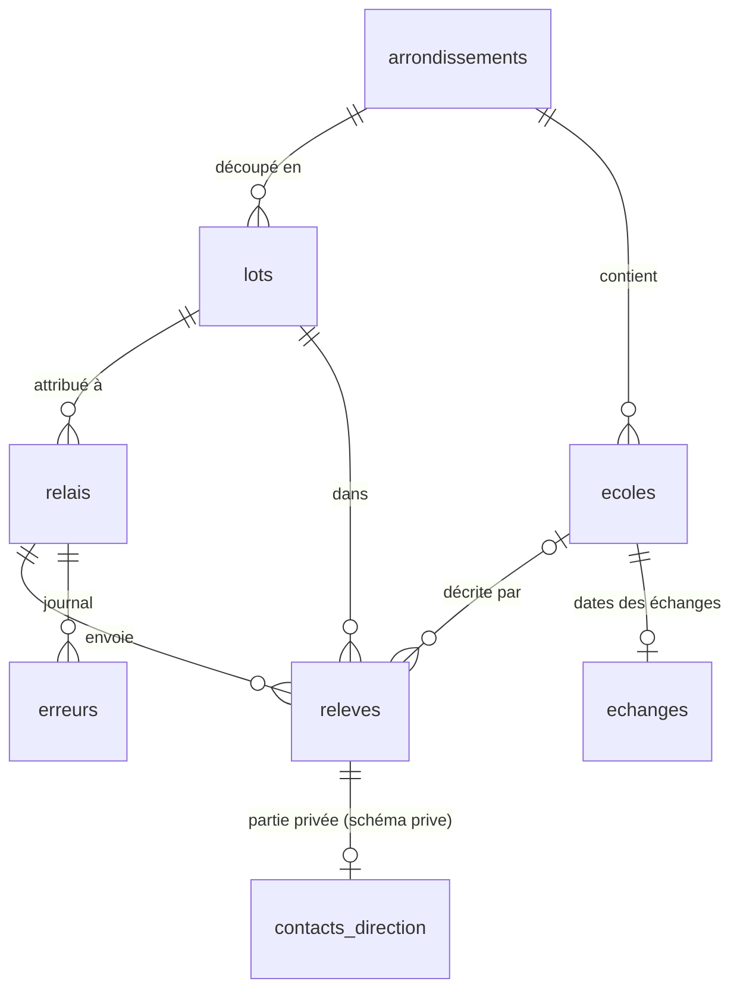
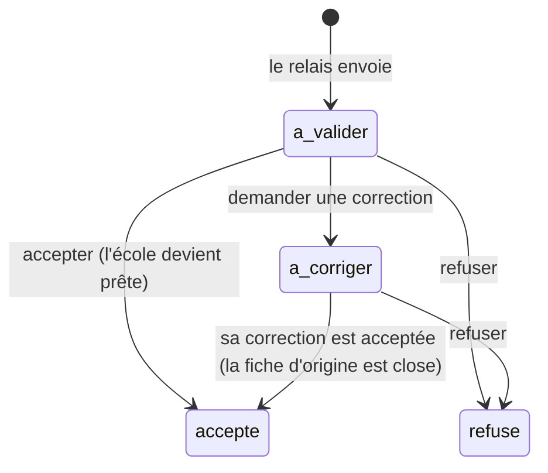
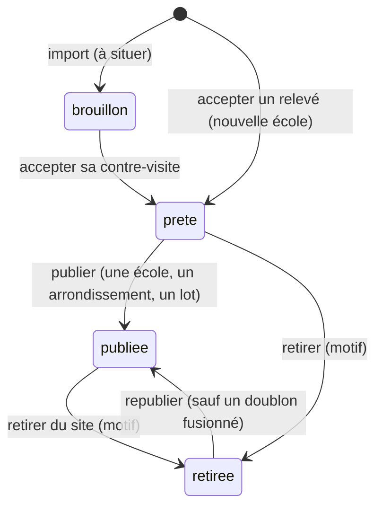

# Le schéma de la base

> **Validé le 31/10/2026** (trois choix tranchés par le fondateur, voir « Choix »). Les migrations (`supabase/migrations/`) font foi ; ce document en garde la carte et les raisons.
>
> Tiré de la proposition technique du 30/10 (modèle de données, droits) et des écrans du canevas « Site NTanova » : Ajouter 1/3 à 3/3, Mes fiches, À valider, Écoles, Compléter une fiche, Relais et paiements.

## Deux principes

1. **Un relevé n'est pas l'école.** Ce qu'un relais envoie est un relevé : une observation datée, signée, avec une position et une photo. L'école, c'est ce que l'administrateur a accepté. Plusieurs relevés peuvent décrire la même école : une correction, une contre-visite. On garde tous les relevés et on publie l'école.
2. **Le privé vit à part.** Les règles d'accès de Postgres filtrent des lignes, pas des colonnes : une colonne privée dans une table lisible finit par fuiter. Le contact de la direction vit donc dans le schéma `prive`, que l'API de Supabase n'expose pas du tout.

## La carte



La photo de l'enseigne va dans le stockage de Supabase (seau privé `releves`), sous `<id du relevé>/enseigne.jpg` : un chemin neutre, qui se copie tel quel ailleurs.

## Les tables (pour lundi 2/11)

| Table | Contenu | Qui lit | Qui écrit |
| --- | --- | --- | --- |
| `arrondissements` | Tié-Tié et Ngoyo : nom, slug, ville, contour OpenStreetMap, relation OSM | Tout le monde | Migration |
| `lots` | Nom, arrondissement, contour (vide : tout l'arrondissement), à rendre le, rendu le, **essai** | Le relais actif (le sien), l'admin | L'admin |
| `relais` | Compte, identifiant Google (`sub`), prénom, statut (en attente, actif, suspendu), lot | Le relais (sa ligne), l'admin | Créé à la première connexion ; l'admin l'active |
| `ecoles` | Ce qui peut être publié : nom, slug, arrondissement, quartier (tel qu'on le dit sur place), type, niveaux, programme, repère, numéro de l'enseigne, position, état, publication, date de relevé (`relevee_le`), dates | Tout le monde : les fiches publiées | L'admin |
| `releves` | Voir ci-dessous | Le relais (les siens), l'admin | Le relais crée ; l'admin décide |
| `echanges` | Par école, des dates : premier message, réponse (et fonction de l'auteur), échange avec le décideur (appel ou rendez-vous), relances. Jamais le contenu | L'admin | L'admin |
| `erreurs` | Le journal de l'application relais, sans donnée personnelle | L'admin | Tout relais connecté (ajout seul) |
| `prive.admins` | Les comptes administrateurs | Personne par l'API | À la main (voir « Le premier jour ») |
| `prive.contacts_direction` | Fonction, nom, WhatsApp, accord pour être contacté (et sa date), ce qui a été dit | **L'admin seul**, par `contact_du_releve()` | Le relais, par `envoyer_contact()`, sans jamais pouvoir relire |

### `releves`, champ par champ

| Champ | Écran | Note |
| --- | --- | --- |
| `id` | — | **Créé sur le téléphone.** Un second envoi du même identifiant est refusé (code `23505`) : c'est « déjà reçu » |
| `relais_id`, `recu_le`, `statut` | — | Imposés par la base, jamais par le téléphone |
| `lot_id`, `type`, `corrige_releve_id` | — | Type : relevé, correction (liée au relevé corrigé), contre-visite. La « contre-visite » de l'application est ce type de relevé (le relais va situer une école connue) ; ne pas la confondre avec la « contre-visite de lot », un contrôle fait à la main hors de l'application |
| `position`, `precision_m`, `pris_le` | 1/3 | Point PostGIS ; précision en mètres ; l'heure du téléphone |
| `reponse_doublon`, `doublon_de` | 1/3 | Ce que le relais a répondu à « une école est déjà relevée à 40 m » |
| `nom_enseigne`, `niveaux`, `type_ecole`, `programme`, `repere`, `numero_enseigne` | 2/3 | Public : ce qui se voit de la rue. `type_ecole` vaut `non_indique` et `niveaux` `{}` tant que le relais n'a rien lu ; `programme` est une ligne libre et facultative (200 signes) |
| `direction`, `fiche_liaison_remise`, `code_liaison`, `repasser` | 3/3 | Ce que « Mes fiches » montre au relais. Le contact lui-même part à part |
| `hors_lot`, `doublon_possible` | — | **Calculés par la base**, une seule fois, à l'arrivée du relevé : à plus de 50 m du contour du lot (ou de son arrondissement, quand le lot n'a pas de contour) ; une école ou un autre relevé à moins de 40 m |
| `motif`, `message_au_relais`, `decide_le`, `ecole_id` | Admin | La décision |
| `contact_confirme_le`, `contact_fonction` | Admin | « Confirmé · promoteur » dans « Mes fiches », sans rien du contact |

### L'ordre d'envoi d'une fiche

**Le relevé, puis la photo, puis le contact** : la photo et le contact ne sont acceptés que pour un relevé déjà reçu et envoyé par le même relais. Chaque envoi peut être rejoué : le second répond « déjà reçu ».

## Le cycle de vie (ticket #10, décidé le 31/10)

### Un relevé



- **Un refus est définitif** : `accepter_releve` refuse un relevé refusé (22023). Pour revenir dessus, le relais envoie une nouvelle fiche.
- Le relais n'annule rien une fois la fiche envoyée ; avant, « Abandonner » efface le brouillon du téléphone.

### Une école



| Geste | Fonction | Ce qu'il fait |
| --- | --- | --- |
| Accepter | `accepter_releve(releve, ecole)` | La donnée est juste : l'école devient **prête** (une école déjà publiée le reste, et la correction paraît à la prochaine construction) |
| Publier une école | `publier_ecole(ecole)` | Prête ou retirée → publiée |
| Publier un arrondissement | `publier_arrondissement(arrondissement)` | Toutes ses écoles prêtes ; rend leur nombre |
| Publier un lot | `publier_lot(lot)` | Les écoles prêtes relevées dans ce lot (par un relevé accepté) ; rend leur nombre |
| Retirer du site | `retirer_ecole(ecole, motif, note)` | Motif (`demande_ecole`, `erreur`, `fermeture`, `doublon`, `autre`), date, note ; la mission confiée s'arrête |
| Fusionner deux doublons | `fusionner_ecoles(doublon, gardee)` | Le doublon est retiré (`doublon`) et renvoie vers l'école gardée ; ses relevés aussi |

- **Corriger une fiche** (onglet « Écoles », « Modifier la fiche », ticket #12) : l'administration change le nom, le type, les niveaux, le programme, le repère et le numéro d'une école à situer, prête ou publiée, **sans repasser par le relais**. Seul ce qui a changé part ; jamais l'adresse de la fiche (le `slug`), ni sa date de relevé. Une école retirée ne se modifie plus. La correction d'une école publiée paraît à la prochaine construction du site.
- **La date « Fiche relevée le … »** est `relevee_le`, posée quand un relevé est accepté (la date de sa photo). Publier ou corriger ne la rajeunit pas : c'est `mis_a_jour_le`, que le déclencheur remet à jour à chaque modification, qui la rajeunissait. Un relevé plus récent l'avance, un relevé plus ancien ne la fait pas reculer. « Fiche vérifiée par la direction le … » lit encore `mis_a_jour_le` : la fiche vérifiée n'existe pas encore.
- **Le site public** montre les écoles publiées, lues à la construction (chaque nuit à 2 h, ou une mise en ligne lancée à la main). Une école retirée n'a plus de page : son adresse affiche « n'existe pas ou n'est plus publiée », **sans son nom**. L'ancienne adresse d'un doublon fusionné renvoie vers l'école gardée (`ecoles_redirections`, sans JavaScript).
- **Jamais de suppression** d'une école ni d'un relevé : l'API n'en a plus le droit. Trois **effacements**, tracés dans `prive.effacements` (quoi, qui, quand) :
  1. `effacer_contact(releve, note)` : le contact de la direction (droit d'effacement, loi n° 29-2019) ;
  2. la **photo** de l'enseigne : l'administration la supprime par l'API du stockage, puis `noter_effacement_photo(releve, note)` ;
  3. la **fusion** de deux doublons (ci-dessus).
- Les motifs de retrait sont une liste fermée (domaine `motif_retrait`), à enrichir au besoin : une migration, et la copie dans `src/modele/listes.ts`.

## Les écoles à situer (31/10, après-midi)

Des écoles connues autrement que par un relevé (les entretiens) entrent **en brouillon, sans position**, parfois sans arrondissement. Jamais de position inventée : une fausse position tromperait une famille et fausserait le contrôle des doublons à 40 m.

1. **Import** : `node outils/importer-ecoles.ts <export.csv> > import.sql`, puis le SQL dans l'éditeur SQL de Supabase. Seulement ce qui se voit de la rue ; la référence (`ETB-…`) va dans `prive.ecoles_sources`, que l'API n'expose pas. Se relance sans doublon. Le CSV et le SQL restent hors du dépôt.
2. **Confier** : `confier_ecole(ecole, relais, note)` (administration, onglet « Écoles ») ; une école est confiée à un seul relais actif à la fois (`ecoles_confiees`). Le relais lit les écoles qu'on lui confie, même en brouillon ; personne d'autre.
3. **Contre-visite** : le relais envoie un relevé `contre_visite`, dont `doublon_de` est l'école visitée (contrainte `releves_contre_visite_liee`).
4. **Accepter** : `accepter_releve(releve, ecole)` met l'école à jour, lui donne l'arrondissement du relevé (sa position, sinon son lot), la publie si elle était en brouillon, et termine la mission (`ecoles_confiees`). Une école publiée a toujours un arrondissement (`ecoles_publiee_dans_un_arrondissement`).

## Situer une école depuis l'administration (31/10, soir, ticket #15)

Le fondateur connaît des écoles : il les situe lui-même, sans attendre un relais, avec la position prise sur une carte (Google Maps : un appui long sur l'entrée de l'école).

- `situer_ecole(ecole, latitude, longitude)` (administration) : l'école reçoit sa position et l'arrondissement dont le contour la contient (`arrondissement_de_position` ; hors de Tié-Tié et Ngoyo, refus 22023). Une école brouillon devient **prête**. Une école publiée ne change pas d'arrondissement (son adresse publique changerait) ; une école retirée ne se modifie plus.
- `ajouter_ecole(nom, latitude, longitude, type_ecole, niveaux, programme, repere, numero_enseigne, quartier)` : une école que la base ne connaît pas. Avec une position, elle est prête ; sans, elle entre à situer (brouillon, sans arrondissement), comme un import. L'adresse (`slug`) vient du nom, avec `-2`, `-3`… si elle est prise.
- Ce n'est pas un relevé : `situee_par` et `situee_le` disent qui a donné la position et quand ; `relevee_le` reste vide. La vue `ecoles_publiees` donne `situee_le` : la fiche dit « Fiche ajoutée par NTanova le … ». Un relevé accepté plus tard remplace la position et pose la date de relevé.
- Migration `20261031223138_situer_par_l_administration.sql` (appliquée en ligne le 31/10 par le connecteur Supabase, à la demande du fondateur ; le fichier porte le numéro que la base a enregistré), tests `supabase/tests/situer_par_l_administration.test.sql`.

## Les lots fins (01/11, ticket #49)

Un lot a un contour facultatif : sans contour, il couvre tout son arrondissement. Un arrondissement ouvert peut être coupé en lots plus fins, pour qu'un relais ait un territoire qu'il couvre en quelques jours et que « hors du lot » ait un sens.

- **Les limites sont une décision du fondateur** (il connaît les zones et les relais) : des lignes tracées sur une carte, de préférence le long d'avenues, pour que la limite se voie sur le terrain. Les quartiers d'OpenStreetMap ne suffisent pas à couper : ils ne couvrent pas l'arrondissement (aucune limite de quartier, des points pour la plupart).
- **On coupe dans la base.** Une migration de données coupe le contour de l'arrondissement avec `ST_Split` le long des lignes (aucun trou ni recouvrement, par construction), nomme chaque morceau, insère les lots, pose leur date « à rendre le », puis appelle `prive.rattacher_releves_aux_lots_fins('<arrondissement>')`. On vérifie avec `select * from prive.problemes_de_lots('<arrondissement>')` : aucune ligne, rien à signaler. Ces deux fonctions sont dans le schéma privé : l'API ne les atteint pas.
- **« Hors du lot » : à plus de 50 m du contour**, dans la base (`releves_avant_insertion`) comme sur le téléphone (`dansLeLot`, `TOLERANCE_LOT_M`) : une limite coupe un quartier et un GPS se trompe de 10 à 30 m. Les deux valeurs se changent ensemble. Le calcul de la base est fait à l'arrivée du relevé et ne bouge plus : c'est pourquoi le rattachement le recalcule.
- **Ce qui reste.** Les lots d'arrondissement entier (« Tié-Tié », « Ngoyo ») et « Essai » restent dans la base : des tests s'appuient sur eux. Vides une fois les relais déplacés (écran « Relais », « Changer de lot »), ils ne servent plus. Un relevé sans position, sur la limite de deux lots, ou du lot d'essai ne se rattache pas.
- **Ce que l'application ne fait pas encore.** « Mon lot » montre le nom et la date, jamais le contour (le relais reçoit une image de son lot) ; aucun écran n'écrit `lots.rendu_le` (SQL à la main) ; le tirage de rues d'une contre-visite de lot est le ticket #52.
- Migrations `20261101180000_tolerance_hors_du_lot.sql` et `20261101180100_controle_des_lots.sql` ; tests `supabase/tests/hors_du_lot.test.sql`, `supabase/tests/lots_fins.test.sql`, `tests/unitaires/geo.test.ts`.

## Les choix (31/10)

1. **Le contact dans un schéma privé**, écrit par une fonction (`envoyer_contact`) qui répond `recu` ou `deja_recu`. Même un droit donné par erreur ne le rendrait pas lisible par l'API. Demain, c'est `POST /contacts` chez Spring Boot.
2. **Pour lundi, un lot = un arrondissement entier** (contour vide). « Hors du lot » signale une école hors de Tié-Tié ou de Ngoyo. Les lots fins viendront quand leurs contours seront dessinés (01/11, ticket #49 : voir « Les lots fins »).
3. **Arrondissements, et un quartier libre** : Tié-Tié et Ngoyo sont des arrondissements ; l'école garde aussi le nom du quartier tel qu'on le dit sur place. Adresse d'une fiche : `ntanova.com/ecoles/tie-tie/<école>/`.

Fixé en écrivant les migrations :

- **Le lot est sur le relais** (`relais.lot_id`) et non l'inverse : plusieurs relais peuvent s'entraîner en même temps sur le lot « Essai ».
- **Une seule liste de niveaux** pour le relais et l'administration (voir « Les listes »). L'« Institut » de l'écran Ajouter 2/3 devient « Technique ou professionnel » ou « Supérieur ».
- **Les listes fermées sont des domaines SQL**, copiés dans `src/modele/listes.ts` ; un test vérifie qu'ils restent identiques.

## Les droits

- **Visiteur** (`anon`) : lit les arrondissements et les écoles publiées (`ecoles_publiees`). Rien d'autre.
- **Relais en attente** : lit sa propre ligne (pour afficher « compte en attente »). Rien d'autre.
- **Relais actif** : envoie des relevés, des photos, des contacts et des erreurs ; lit ses relevés, son lot et les écoles publiées. **Ne lit jamais un contact, même le sien.** N'écrit que les colonnes du téléphone.
- **Admin** : tout, depuis son compte Google inscrit dans `prive.admins`, ou depuis l'éditeur SQL de Supabase Studio (rôle `postgres`).
- La migration des droits retire d'abord tout, puis donne table par table : en local, Supabase donne par défaut tous les droits à `anon` et `authenticated` ; en ligne, aucun. Les deux bases ont ainsi les mêmes droits.

## Les fonctions

| Fonction | Pour qui | Ce qu'elle fait |
| --- | --- | --- |
| `envoyer_contact(releve, fonction, nom, whatsapp, accord, accord_le, note)` | Relais actif | Range le contact ; répond `recu` ou `deja_recu`. Sans accord, aucun numéro |
| `activer_relais(relais, lot)` | Admin | Active un relais après sa formation et lui donne un lot |
| `accepter_releve(releve, ecole)` | Admin | Crée la fiche relevée, prête (ou met à jour l'école donnée, sauf si elle est vérifiée) ; jamais pour le lot d'essai. Une **correction** reprend l'école de la fiche corrigée et clôt celle-ci (« acceptée », même école). **Pose la date de relevé** de l'école (`relevee_le` : la date de la photo, jamais reculée). Sur une école connue, **« Pas indiqué » et « aucun niveau » n'effacent rien** (comme le repère et le numéro vides) : un relevé qui dit quelque chose remplace, un relevé muet laisse ce que l'école savait |
| `demander_correction(releve, motif, message)` | Admin | « La photo est floue, reprenez-la de face » |
| `refuser_releve(releve, motif, message)` | Admin | Refuse, avec un motif de la liste |
| `confirmer_contact(releve, fonction)` | Admin | La personne a confirmé sa fonction sur WhatsApp |
| `contact_du_releve(releve)` | Admin | Lit le contact d'un relevé |

Deux vues : `ecoles_publiees` (ce que lit le site public) et `releves_a_valider` (la file de l'administration, avec photo reçue et contact reçu).

## Les listes (types, niveaux…) : des listes qui ne bloquent personne

Ticket #12, décidé le 31/10 : le fondateur n'a pas de faits pour trancher une typologie (sur les neuf lignes du Sheet des entretiens, sept sont « Privé » ou « Privé (probable) », une n'a pas de type, une est une université ; aucune publique, confessionnelle ni communautaire), et il veut un système qui ne le bloque pas, avec les cases qu'il faut aux relais et aux visiteurs. D'où des règles, qui valent pour **toute liste fermée** d'un écran relais ou administration :

- **Une case de sortie**, toujours : `autre` (c'est écrit, mais ça ne rentre dans aucune case) et `non_indique` (rien n'est écrit).
- **Rien n'est obligatoire** pour envoyer une fiche, et rien n'est coché d'avance si cela fausse la donnée : le défaut est `non_indique`, comme dans la base.
- **Un texte libre facultatif** capte ce que la liste ne sait pas encore (`programme`). On structure plus tard, à partir des mots qui reviennent.
- **On ne retire et on ne renomme jamais une valeur.** Pour changer un mot, on change le libellé. Un test refuse qu'une migration retire une valeur.
- **Les lectures sont tolérantes** : une valeur que le code ne connaît pas encore (`typeConnu`, `niveauxConnus` dans `src/modele/listes.ts`) se lit « Pas indiqué » ou se laisse de côté, sur le site, dans l'administration et dans le relais. Jamais d'erreur, jamais d'écran qui ne répond plus.
- **L'administration corrige** une fiche sans repasser par le relais.
- Chacun voit sa vue de la même liste : le relais, de grosses cases ; l'administration, le détail ; le visiteur, des mots simples (« Pas indiqué » et « Autre » ne s'écrivent pas : ils rejoignent « Pas encore sur la fiche »).

| Liste | Valeurs (dans l'ordre de l'écran du relais) |
| --- | --- |
| `type_ecole` | Privée · Publique · Confessionnelle · **Communautaire** · **Autre** · Pas indiqué (défaut) |
| `niveau` (plusieurs possibles, aucun n'est obligatoire) | **Crèche ou garderie** · Maternelle · Primaire · Collège · Lycée · **Technique ou professionnel** (valeur `technique`) · Supérieur · **Autre formation** |

En gras : ajouté par le ticket #12. L'alphabétisation n'a pas sa case : aucune école n'en a été vue, « Autre formation » la reçoit, et la recette ci-dessous l'ajoute le jour où l'on en voit une.

### La recette : ajouter une valeur à une liste

1. **Une migration** : `alter domain public.<liste> drop constraint <liste>_check;` puis `alter domain public.<liste> add constraint <liste>_check check (value in (…)) not valid;`. **`not valid` est obligatoire** : `niveaux` est une colonne en tableau (`niveau[]`), que PostgreSQL ne sait pas revalider, et il refuse sinon (« cannot alter type … because column … uses it »). Sans danger : élargir une liste n'invalide aucune ligne, et la contrainte refuse toujours une valeur inconnue dans les données qui arrivent. Ne jamais lancer `validate constraint`.
2. **`src/modele/listes.ts`** : la valeur, dans le même ordre que la migration.
3. **`src/modele/libelles.ts`** : son mot.
4. **`pnpm verif`** : le test des listes compare le code et les migrations (même valeurs, même ordre) et refuse qu'une migration retire une valeur ; le test des libellés vérifie que chaque valeur a son mot.
5. **`pnpm exec supabase db push` AVANT la mise en ligne** du code qui la propose : sinon un téléphone enverrait une valeur que la base refuse.

Un quart d'heure, sans toucher aux écrans : le relais et l'administration lisent les listes dans le code, le site aussi.

## Les tests

`pnpm base:tests` (pgTAP, `supabase/tests/`) : 124 vérifications (39 pour les droits, 20 pour les décisions de l'administration, 17 pour les écoles à situer, 22 pour le cycle de vie, 16 pour les listes et le programme, 10 pour la date de relevé et la correction), dont celles du « fini quand » de la base : un relais ne lit aucun contact, même le sien ; un second envoi du même relevé répond « déjà reçu ». Ils tournent aussi dans la CI. Vérifié le 31/10 : en donnant à tort un droit aux relais, les tests échouent.

## Voir le schéma en local

1. `pnpm base:demarrer` (Docker), puis `pnpm base:reset` pour rejouer les migrations.
2. Supabase Studio : http://127.0.0.1:54323, menu **Database**, puis **Schema Visualizer** (schémas `public` et `prive`).

## Le premier jour en ligne

1. Relire les migrations, puis `pnpm exec supabase db push` (le mot de passe de la base est demandé).
2. Te connecter une première fois avec Google sur le site d'essai : la base crée ta ligne de relais, en attente.
3. Dans l'éditeur SQL de Supabase Studio, t'inscrire comme administrateur, avec ton adresse :

   ```sql
   insert into prive.admins (id) select id from auth.users where email = '<ton adresse>';
   ```

4. Pour chaque relais, après sa première connexion : dans l'administration (`/admin/`, onglet « Relais »), choisir son lot puis « Activer ». Sans l'administration : `select activer_relais('<son id>', (select id from lots where nom = 'Tié-Tié'));`

## Plus tard dans la semaine

| Quoi | Quand |
| --- | --- |
| `codes_liaison` : code, paquet, relais, imprimé le, relevé qui l'a utilisé. Le relais lit les codes de son paquet | Avant le premier paquet imprimé |
| Colonnes de la fiche vérifiée dans `ecoles` (frais datés, effectif, enseignants, séries, équipements, examens, mot de la direction, WhatsApp publié) et `ecoles_prive` (agrément, accord de publication, grille des frais, notes) | Avec « Compléter une fiche » |
| `photos` : façade, salle, cour, grille des frais ; publique ou non ; « sans enfant » vérifié le | Avec la fiche vérifiée |
| `evenements` : clic WhatsApp, scan d'autocollant ; école, canal, date | Avec le compteur `/go/` |
| Paiements des relais | Pas en novembre : le Sheet suffit |
