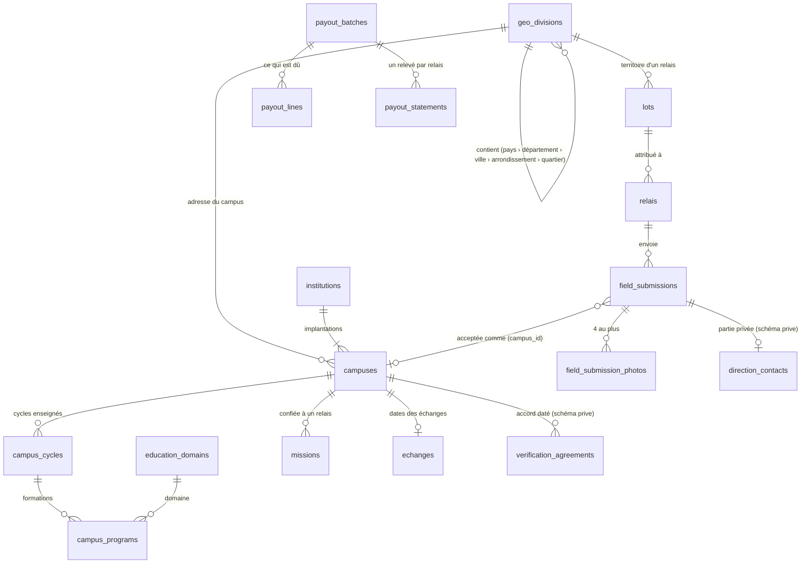

# Le schéma de la base

> **Version 2, du 02/11/2026** : le catalogue universel (plateforme pour tout le Congo, extensible à d'autres villes et d'autres pays). Les migrations (`supabase/migrations/`, 25 fichiers) **font foi** ; ce document en garde la carte et les raisons. La version 1 (une table `ecoles`, un `arrondissement` fixe) est reprise par les migrations `20261101200000` à `20261101201000` : les données d'avant se migrent sans perte (preuve plus bas).
>
> Structure **en anglais** (tables, colonnes, fonctions), vocabulaire **en français** : les ports (`src/modele/ports.ts`) et l'interface parlent français, seuls les adaptateurs de `src/infra/supabase/` traduisent. Les noms d'avant restent (`relais`, `lots`, `echanges`, `erreurs`, `prive`) : les renommer n'apporte rien et aurait risqué le lancement du 02/11 ; c'est faisable plus tard avec la même technique.

## Quatre principes

1. **Un relevé n'est pas l'école.** Ce qu'un relais envoie est un relevé (`field_submissions`) : une observation datée, signée, avec une position et des photos. L'école, c'est ce que l'administrateur a accepté (`accept_submission`). Un relais **n'écrit que dans `field_submissions`** (et, par fonction, ses photos et son contact) : jamais dans le catalogue, la géographie ou les lots. Les tests le vérifient.
2. **Le privé vit à part.** Les règles d'accès (RLS) filtrent des lignes, pas des colonnes : une colonne privée dans une table lisible finit par fuiter. Le contact de la direction, les accords, les numéros Mobile Money, les références d'import vivent dans le schéma `prive`, qu'**aucun rôle de l'API** ne lit : seules des fonctions `security definer` le touchent, après `exiger_admin_session()`.
3. **Portable.** Le cœur (`public` et `prive`) ne dépend de rien de Supabase : extensions de PostgreSQL (`postgis`, `pg_trgm`, `unaccent`, `ltree`), identité par `public.current_user_id()`, aucun objet `auth` ni `storage`. Ce qui est propre à Supabase est isolé dans `20261101200900_supabase_couche.sql`. Voir « Sortir de Supabase ».
4. **Aucune donnée inventée.** Les migrations ne portent que de la géographie administrative, avec sa source et la date où elle a été confrontée (`geo_divisions.source`, `verified_on`). Aucune école, aucun quartier, aucune position dans une migration : les écoles entrent par un relais ou par l'administration, et **sans position elles restent « à situer »**.

## La carte



## Les tables

| Table | Rôle | À retenir |
| --- | --- | --- |
| `geo_divisions` | La géographie, du pays au quartier, auto-référencée | `level` 0 pays · 1 département ou région · 2 ville, commune, district · 3 arrondissement · 4 quartier ou zone ; `kind` lié au niveau ; `path` (`ltree`) donne un sous-arbre en une comparaison ; `parent_level` et une clé étrangère composite garantissent que le niveau suit celui du parent ; `open_for_fieldwork` : la zone est ouverte aux relais (**faux partout sauf Tié-Tié et Ngoyo** ; ouvrir une zone ouvre tout ce qu'elle contient) ; `boundary` (contour), `aliases` (« Mvoumvou »), `source`, `verified_on` |
| `institutions` | « Complexe scolaire X », « Université Y » : un nom et un genre | `kind` = `type_ecole` ; une institution a un ou plusieurs campus |
| `campuses` | Une implantation physique | `slug` unique dans sa division (adresse publique) ; `position` (PostGIS) ; `publication` : `brouillon` → `prete` → `publiee` → `retiree` ; `origin` : `field` (relevée par un relais) · `admin` · `import` ; `verification_state` : `relevee` ou `verifiee`, et `verifiee` exige `verified_on` (l'accord daté de la direction) ; `replaced_by_campus_id` (fusion de doublons) |
| `campus_cycles` | Les cycles enseignés dans un campus | `cycle` = `niveau` (crèche → supérieur, autre formation), un par cycle |
| `campus_programs` | Les formations d'un cycle | `title` libre, `bac_track` (série), `diploma`, `domain_id`, `rhythms` ; `origin` ; `source_submission_id` ; un même titre n'entre qu'une fois dans un cycle |
| `education_domains` | Informatique, Gestion, BTP, Santé… | `parent_id` (arbre), `sort_order` ; l'administration en ajoute |
| `field_submissions` | Un relevé du terrain | `kind` : `releve` · `correction` · `contre_visite` ; position et précision ; `levels`, `school_kind`, `observed_programs` (séries ou filières vues), `programs_photographed` ; `duplicate_of_campus_id` et `duplicate_answer` ; `status` : `a_valider` · `a_corriger` · `accepte` · `refuse` ; `outside_batch` (plus de 50 m du lot : **une information**), `division_id` (la division la plus fine dont le contour contient la position), `in_open_zone` (cette division est ouverte aux relais ; **nul** quand aucun contour connu ne contient la position : « zone inconnue » n'est pas « hors zone ») et `possible_duplicate` (**calculés à l'arrivée par la base**, jamais par le téléphone) ; `payable` ; `trial_validated_at` (lot d'essai) |
| `field_submission_photos` | Les photos d'un relevé | **Une enseigne** (`signboard`, la seule obligatoire) **puis trois autres au plus** (`programs_board`, `brochure`, `building`) ; `storage_path` **relatif** (une contrainte refuse toute adresse de serveur) ; `bytes` ≤ 2 Mo (le téléphone envoie moins de 200 Ko) ; **privée tant que l'administration n'a pas vérifié « sans enfant ni donnée personnelle »** (`is_public` exige `child_free_checked_at`) |
| `missions` | Une école connue, confiée à un relais | `kind` : `verify` · `locate` · `complete` ; **une seule mission ouverte par campus** |
| `lots` | Le secteur conseillé d'un relais : un nom, une date, un objectif. **Jamais une barrière** : la limite du relais est la zone ouverte (ticket #67). Un relais peut n'avoir aucun lot | Sur **n'importe quelle** division (`geo_division_id`), contour facultatif ; `essai` : lot d'entraînement (ses fiches ne sont jamais publiées) ; **une zone fermée ne reçoit pas de lot** (sauf d'essai) |
| `relais` | Un relais (même identifiant que son compte) | `statut` : `en_attente` · `actif` · `suspendu` ; `lot_id` |
| `echanges` | Dates des échanges avec l'école | Premier message, réponse, relances : des dates, jamais le contenu |
| `erreurs` | Journal des erreurs de l'application relais | Écrit par le téléphone, lu par l'administration |
| `payout_rates` | Les tarifs, **datés** | Depuis le 01/11/2026 : 500 FCFA par fiche acceptée, +300 FCFA par contact confirmé, essai de 3 fiches validées = 1 500 FCFA. Un tarif change par une nouvelle ligne ; les anciens paiements gardent le leur |
| `payout_batches`, `payout_lines`, `payout_statements` | La paie du vendredi | Une clôture par vendredi ; une ligne par élément payé (**jamais deux fois** : unique par relevé et par nature, l'essai une seule fois par relais) ; un relevé par relais, « payé » avec la référence de l'opération |

Schéma `prive` (aucun droit pour l'API) : `admins`, `direction_contacts` (fonction, nom, WhatsApp, accord et sa date), `verification_agreements` (l'accord daté de la direction pour « Vérifié » : la date et le canal, jamais le message), `relay_payment_details` (opérateur, numéro Mobile Money), `campus_sources` (la référence anonyme `ETB-…` d'un import), `erasures` (le journal du droit d'effacement : quoi, quand, par qui, sans le contenu).

### Les vues

| Vue | Pour qui | Ce qu'elle montre |
| --- | --- | --- |
| `public_campuses`, `public_campus_cycles`, `public_campus_programs` | Le site public (clé `publishable`) | Les seuls campus **publiés**, avec leur adresse (`division_slugs`, `division_names`), leurs cycles et leurs formations. Jamais le contact d'une personne, jamais une photo privée |
| `public_campus_redirects` | Le site public | Les anciennes adresses des doublons fusionnés, et la fiche gardée : le site les redirige |
| `submissions_to_review` | L'administration | Les relevés à valider, avec ce qu'il faut pour décider |
| `relay_counters` | L'administration | Par relais : envoyées, à valider, à corriger, acceptées, refusées, contacts confirmés |
| `division_stats` | L'administration | Par zone : écoles, publiées, relevées / ajoutées / importées (**les écoles amorcées ne gonflent jamais « relevées par un relais »**) |

### Les adresses publiques

`ntanova.com/ecoles/<pays>/<département-ou-ville>/<arrondissement>/<quartier>/<campus>/`. Pointe-Noire est à la fois un département et une ville (deux lignes de même nom, l'une sous l'autre) : l'adresse saute la répétition. Deux règles de la base (`20261101201000`) : **une adresse n'a qu'un propriétaire** (la page d'une zone ou la fiche d'un campus, jamais les deux sous une même division), et `unique_campus_slug` ajoute `-2`, `-3`… quand une adresse est prise. Quand une fiche est fusionnée avec une autre, l'ancienne adresse **renvoie** vers la gardée (`public_campus_redirects`).

## Les fonctions

Les paramètres portent le préfixe `p_`, les variables locales `v_` (sauf `activer_relais(relais, lot)`, héritée de la version 1). Chaque fonction qui touche `prive` est `security definer` et commence par `exiger_admin_session()` : le rôle courant y est le propriétaire, on regarde donc le jeton, la personne connectée et le rôle pris par `set role`.

| Pour | Fonctions |
| --- | --- |
| Le relais (téléphone) | `my_batch()` (son lot) · `known_places_for_me()` (les écoles connues de **toutes les zones ouvertes**, plus de son secteur s'il en a un, pour l'alerte à 40 m **sans réseau**, où qu'il soit ; `known_places_in_my_batch()`, qui ne couvrait que le lot, reste en place pour les téléphones déjà installés et sera retirée par une migration ultérieure) · `my_missions()` (les écoles qu'on lui confie, avec ce que NTanova en sait : position, état de vérification, **photos par rôle sans leur chemin**, contact de la direction confirmé ou non) · `my_submissions()` (**ses** fiches, avec tout ce qu'elles contiennent, la décision de NTanova, les photos par rôle, et « le contact est arrivé » sans le lire : de quoi préremplir « Compléter » et « Corriger » ; migration `20261102100000`, ticket #55) · `my_submission_photos(p_submission)` (**les photos d'UNE de ses fiches** : identifiant, rôle, chemin relatif ; rien pour la fiche d'un autre ni pour un relais inactif ; avec la règle du seau « le relais actif relit les photos de ses relevés », elle laisse le relais **revoir ce que NTanova a reçu** quand il corrige une fiche ; migrations `20261103100000` et `20261103100100`, ticket #72) · `register_photo(…)` (enregistre une photo reçue ; répond « déjà reçu » à un envoi rejoué) · `send_contact(…)` · `contact_received(p_submission)` (« le contact est arrivé », sans le lire) |
| Décider d'un relevé | `accept_submission(p_submission, p_mode, p_campus, p_institution, p_label, p_programs, p_division)` : **en un geste**, `new_institution` · `new_campus` · `update_campus` · `add_cycle`, avec les formations lues sur les photos · `request_correction` · `refuse_submission` (un refus est définitif ; **avec le motif `autre`, le message est obligatoire** : migration `20261103110000`, ticket #80) · `contact_of_submission` · `confirm_contact` (la fonction confirmée débloque le +300 FCFA ; pas le secrétariat) · `validate_trial_submission` (lot d'essai : compte pour la paie, ne publie jamais) · **`p_division`** (facultatif) : la division de l'école, choisie par l'administration ; elle l'emporte sur celle de la position, et elle est **obligatoire quand aucun contour connu ne contient la position** : la fiche ne retombe plus sur la division du lot du relais (ticket #67). Sans position, la division du lot reste le repli |
| Amorcer sans relais | `create_catalog_entry(p_entry)` (une école d'un coup : institution, campus, cycles, formations) · `import_catalog(p_entries, p_dry_run)` (une liste, **simulation d'abord** : rien n'est écrit tant que `p_dry_run` est vrai ; rejouable sans doublon grâce à la référence) |
| Le catalogue | `publish_campus` · `publish_division` · `publish_batch` · `retire_campus` (avec motif) · `merge_campuses(p_duplicate, p_kept)` · `locate_campus` (position prise par l'administration : jamais inventée) · `upsert_programs` · `record_verification` (l'accord daté, badge « Vérifié ») · `erase_contact` · `erase_photo` |
| Les zones et les lots | `set_division_open` · `create_lot` · `mark_batch_returned(p_batch, p_returned)` (un lot est **rendu** quand l'administration le déclare terminé : `lots.rendu_le`) · `activer_relais` · `assign_mission` · `cancel_mission` |
| La vue d'ensemble | **`admin_overview(p_days)`** (ticket #76 ; migration `20261103110100`) : un appel, des agrégats en JSON, **administration seule, lecture seule, aucun seuil** : fiches à valider (nombre, plus ancienne, plus de 24 h), relevés par jour (le lot d'essai à part, jours à l'heure de Pointe-Noire), délai de décision et photos d'enseigne sur 30 jours, contacts confirmés, relais par statut et relais qui ont envoyé une fiche cette semaine (**`relais.active_le` est la date d'activation, jamais une activité**). Les écoles par zone viennent de `division_stats` / `divisions()`. |
| La paie | `payout_preview(p_friday)` (ce qui est dû, sans rien écrire) · `close_payout_week(p_friday)` (un vendredi, une fois) · `payout_statements_of` · `mark_statement_paid(p_batch, p_relay, p_reference)` · `set_relay_payment_details` · `payable_items(p_friday)` (le calcul brut, administration seule) · **`my_payout(p_friday)`** (le relais lit **sa** paie : l'acquis du prochain vendredi, puis les semaines closes « à payer » ou « payées » avec la référence ; jamais le numéro Mobile Money, seulement si NTanova l'a ; migration `20261102110000`, ticket #55) |

> **Un seul calcul de la paie.** `payable_items` (administration) et `my_payout` (relais) appellent la même fonction privée `prive.payable_items_for(p_friday)` : les montants que le relais lit sont ceux de l'administration, par construction (`supabase/tests/ma_paie.test.sql` le vérifie). Cette fonction n'est exécutable par aucun rôle de l'API.
| Chercher | `search_campuses(…)` : nom, repère, cycle, série, diplôme, domaine, rythme, zone, distance. **Les critères de formation portent sur UNE MÊME formation** (« série C » et « soir » = une formation du soir en série C). `f` et `g` trouvent aussi F1 à F4 et G1 à G3 |
| Outils | `current_user_id()` · `est_admin()` · `exiger_admin()` · `exiger_admin_session()` · `norm_text()` (minuscules sans accents, indexable) · `slugifier()` · `division_of_position()` · `is_open_for_fieldwork()` · `register_relay()` (à la première connexion ; aucun rôle de l'API) |
| Maintenance (schéma `prive`, aucun rôle de l'API) | `prive.attach_submissions_to_fine_lots(p_division)` · `prive.lot_problems(p_division)` |

## Les droits

Tout est d'abord **retiré**, puis donné table par table (`20261101200800`) : en local Supabase donne tout aux nouvelles tables, en ligne rien ; ainsi les deux bases ont exactement les mêmes droits.

- **`anon` (un visiteur)** : lit les vues `public_*`, `geo_divisions`, `education_domains` et les campus **publiés** (par RLS). Rien d'autre.
- **`authenticated` (un relais)** : écrit `field_submissions` **colonne par colonne** (ce que remplit le téléphone ; jamais le statut, l'auteur, la paie, `campus_id`, `outside_batch`) ; lit ses relevés, son profil et ses missions ; appelle les fonctions du terrain. Ne lit **aucun** contact, même le sien.
- **L'administration** (`prive.admins`) : les mêmes jetons, des règles de plus : elle lit tout le terrain, écrit le catalogue, les zones, les lots, les tarifs ; ses fonctions refusent tout autre appel.
- **Jamais de suppression** d'une institution, d'un campus ni d'un relevé par l'API : on retire (`retire_campus`), on fusionne, on efface un contact ou une photo par leur fonction, qui garde la trace de l'effacement.

## Les listes (types, niveaux…) : des listes qui ne bloquent personne

Les listes fermées sont des **domaines SQL**, copiés dans `src/modele/listes.ts` (un test vérifie qu'ils restent identiques, même ordre). Règles, pour **toute liste fermée** d'un écran relais ou administration :

- **Une case de sortie**, toujours : `autre` (c'est écrit, mais ça ne rentre dans aucune case) et `non_indique` (rien n'est écrit). Rien n'est obligatoire pour envoyer une fiche, et rien n'est coché d'avance si cela fausse la donnée.
- **Un texte libre facultatif** capte ce que la liste ne sait pas encore (`curriculum_note`, le `title` d'une formation).
- **On ne retire et on ne renomme jamais une valeur.** Pour changer un mot, on change le libellé. Un test refuse qu'une migration retire une valeur.
- **Les lectures sont tolérantes** : une valeur que le code ne connaît pas encore (`typeConnu`, `niveauxConnus`) se lit « Pas indiqué » ou se laisse de côté, jamais d'erreur.

| Liste | Valeurs |
| --- | --- |
| `type_ecole` | publique · privee · confessionnelle · communautaire · autre · non_indique |
| `niveau` | creche · maternelle · primaire · college · lycee · technique · superieur · autre_formation |
| `geo_kind` | country · department · region · city · commune · district · arrondissement · quarter · zone |
| `bac_track` | a · c · d · e · f · f1 · f2 · f3 · f4 · g · g1 · g2 · g3 · h · autre |
| `diploma_kind` | cepe · bepc · bac · bt · bts · licence · master · doctorat · cap · certificat · autre |
| `study_rhythm` | jour · soir · weekend |
| `photo_role` | signboard · programs_board · brochure · building |
| `origin_kind` | field · admin · import |
| `mission_kind`, `mission_status` | verify · locate · complete, et open · done · cancelled |
| Les autres (`fonction_direction`, `motif_decision` (dont `position_imprecise`, qui remplace `hors_lot` dans ce que l'administration propose ; `hors_lot` reste pour relire), `statut_releve`, `type_releve`, `statut_relais`, `direction_vue`, `reponse_doublon`, `etat_ecole`, `publication`, `motif_retrait`, `type_echange`) | Voir `src/modele/listes.ts` |

### La recette : ajouter une valeur à une liste

1. **Une migration** : `alter domain public.<liste> drop constraint <liste>_check;` puis `alter domain public.<liste> add constraint <liste>_check check (value in (…)) not valid;`. **`not valid` est obligatoire** : `levels` est une colonne en tableau (`niveau[]`), que PostgreSQL ne sait pas revalider. Sans danger : élargir une liste n'invalide aucune ligne. Ne jamais lancer `validate constraint`.
2. **`src/modele/listes.ts`** : la valeur, dans le même ordre que la migration.
3. **`src/modele/libelles.ts`** : son mot.
4. **`pnpm verif`** : le test des listes compare le code et les migrations ; celui des libellés vérifie que chaque valeur a son mot.
5. **`pnpm exec supabase db push` AVANT la mise en ligne** du code qui la propose : sinon un téléphone enverrait une valeur que la base refuse.

## Les lots fins

Un lot a un contour facultatif : sans contour, il couvre toute sa division. Une division ouverte peut être coupée en lots plus fins, pour qu'un relais ait un territoire qu'il couvre en quelques jours et que « hors du lot » ait un sens.

- **Les limites sont une décision du fondateur** : des lignes tracées sur une carte, de préférence le long d'avenues. Les lots fins sont des **secteurs conseillés** (décision du 02/11 : le secteur reste l'unité de la mesure de complétude) ; ils se tracent après les premiers jours de relevé réel.
- **On coupe dans la base** : une migration de données coupe le contour avec `ST_Split` (aucun trou ni recouvrement, par construction), insère les lots, puis appelle `prive.attach_submissions_to_fine_lots('<division>')`. On vérifie avec `select * from prive.lot_problems('<division>')` : aucune ligne, rien à signaler (trous, recouvrements, débordements au-dessus de 1 000 m²).
- **« Hors du lot » : à plus de 50 m du contour**, une **information** calculée par la base à l'arrivée du relevé (`outside_batch`) ; le rattachement la recalcule. Le téléphone ne la calcule plus (ticket #67) : un secteur est un conseil, pas une limite. Ni le refus d'une fiche ni la paie ne la lisent ; l'administration voit plutôt `in_open_zone` (« Hors zone ouverte » ou « Zone inconnue », en information).

## Sortir de Supabase

**Prouvé** (`supabase/portabilite/banc.sh verifier`, rejoué le 02/11/2026) : les 25 migrations se rejouent sur un PostgreSQL 16 + PostGIS jetable ; les 425 tests pgTAP passent ; un `pg_dump` des schémas `public` et `prive` se restaure sur un PostgreSQL **ordinaire** (aucun objet `auth` ni `storage`) où 403 tests « cœur » passent encore ; la migration des données de la version 1 conserve identifiants, adresses, statuts, contacts et missions (29 contrôles). **Non éprouvé** : l'API et les fichiers sur un autre serveur (ci-dessous).

### Le conteneur à soi, pas à pas

```bash
# 1. Exporter les deux schémas (depuis Supabase, ou tout autre PostgreSQL)
pg_dump "$URL_DE_LA_BASE" --schema=public --schema=prive --no-owner --format=plain \
  --quote-all-identifiers > ntanova.sql

# 2. Un PostgreSQL avec PostGIS
docker run -d --name ntanova-pg -e POSTGRES_PASSWORD=… -p 5432:5432 postgis/postgis:16-3.4
```

```sql
-- 3. Préparer la base : les extensions natives, les deux rôles de l'API, un schéma public vide
create schema extensions;
create extension postgis  with schema extensions;
create extension pg_trgm  with schema extensions;
create extension unaccent with schema extensions;
create extension ltree    with schema extensions;
create role anon          nologin noinherit;
create role authenticated nologin noinherit;
create role service_role  nologin noinherit;   -- nommé dans les droits d'un export fait depuis Supabase
grant usage on schema extensions to anon, authenticated;
alter database ntanova set search_path = "$user", public, extensions;
drop schema public cascade;   -- celui d'une base neuve est vide : l'export le recrée avec tout son contenu
```

```bash
# 4. Restaurer
psql "$URL_DU_CONTENEUR" -f ntanova.sql
```

- **Les rôles de la plateforme** : un export fait depuis Supabase nomme `service_role` dans les droits de ses objets, et peut nommer `postgres` ou `supabase_admin` dans des lignes `ALTER DEFAULT PRIVILEGES`. Créez ces rôles (sans connexion) avant de restaurer, ou retirez ces lignes de `ntanova.sql`. **Éprouvé avec le simulacre du banc, pas encore avec une vraie sauvegarde.**
- **L'API** : un PostgREST (`PGRST_DB_SCHEMAS=public`, `PGRST_DB_ANON_ROLE=anon`) devant la base. L'identité d'une requête est celle de son jeton : `public.current_user_id()` lit `request.jwt.claims` (ou `request.jwt.claim.sub`), comme le font PostgREST et Supabase, avec un rôle `authenticated` ou `anon`. La pile Supabase auto-hébergée (Docker) convient telle quelle ; un autre serveur demande de remplacer `src/infra/supabase/` par un adaptateur du même port (`src/modele/ports.ts` ne change pas).
- **Les comptes** : tout serveur d'identité appelle `public.register_relay(id, google_sub, prénom)` à la première connexion ; l'administrateur s'inscrit dans `prive.admins`.
- **Les photos** : la base ne garde qu'un chemin relatif (`field_submission_photos.storage_path`, par exemple `<relevé>/<photo>.webp`) ; une contrainte refuse tout ce qui ressemble à une adresse de serveur. Le fichier va dans le stockage de son choix (S3, MinIO, un dossier), au même chemin. Le seau `releves` et ses règles sont dans la couche Supabase, qu'on remplace. Le relais relit les fichiers de **ses** relevés (le dossier du fichier est un de ses relevés), jamais ceux d'un autre ; il lit leur chemin par `my_submission_photos`, jamais la table des photos.
- **Ce qui est propre à Supabase** (le déclencheur sur `auth.users`, le seau et ses règles) tient dans une migration, `20261101200900_supabase_couche.sql`, dont chaque instruction est gardée : sur un PostgreSQL sans `auth` ni `storage`, elle ne fait rien.

## Les tests

- **`pnpm base:tests`** (pgTAP, `supabase/tests/`, Docker et Supabase CLI) : **425 vérifications** en 12 fichiers (droits, géographie, catalogue, terrain, décisions de l'administration, import, lots, paie, recherche, adresses, portabilité, couche Supabase). Les droits sont éprouvés des deux côtés : en donnant à tort un droit à un relais, les tests échouent.
- **`supabase/portabilite/banc.sh`** : la même chose sans Docker (PostgreSQL 16 jetable et une couche de compatibilité, `shim-supabase.sql`, qui n'entre jamais dans une migration) ; `verifier` enchaîne rejeu, tests, export, restauration sur base nue, tests « cœur » et migration de données.
- **`tests/unitaires/contrat-schema.test.ts`** : tout ce que l'adaptateur appelle (fonctions et paramètres, tables, vues, colonnes, liens entre tables, seaux) existe dans les migrations. Les parcours de bout en bout tournent sur un faux serveur : sans ce test, une faute de frappe dans un nom de colonne ne se verrait qu'en production.

## Voir le schéma en local

1. `pnpm base:demarrer` (Docker), puis `pnpm base:reset` pour rejouer les migrations.
2. Supabase Studio : http://127.0.0.1:54323, menu **Database**, puis **Schema Visualizer** (schémas `public` et `prive`).

## Le premier jour en ligne

Les migrations s'appliquent **depuis le Mac du fondateur, après relecture, jamais depuis la CI**, et **avant** la mise en ligne du code (jamais l'inverse), après une sauvegarde de la base.

> **Attention, la version 2 renomme et retire des tables et des fonctions, sans couche de compatibilité.** Entre `db push` et le déploiement du nouveau code, l'application relais en ligne ne peut plus envoyer (ses fiches attendent dans le téléphone et partent après la mise à jour) et l'administration en ligne ne marche plus. Faire `db push` et la mise en ligne **à la suite**, de nuit, puis ouvrir `essai.ntanova.com` tout de suite après. Un essai à blanc : restaurer une sauvegarde de la base en ligne dans le banc (`supabase/portabilite/banc.sh`) et y rejouer les migrations.

1. Relire les migrations, puis `pnpm exec supabase db push` (le mot de passe de la base est demandé).
2. Te connecter une première fois avec Google sur le site d'essai : la base crée ta ligne de relais, en attente (`register_relay`).
3. Dans l'éditeur SQL de Supabase Studio, t'inscrire comme administrateur :

   ```sql
   insert into prive.admins (id) select id from auth.users where email = '<ton adresse>';
   ```

4. Pour chaque relais, après sa première connexion : dans l'administration (`/admin/`, onglet « Relais »), choisir son lot puis « Activer ». Ouvrir une zone aux relais : onglet « Zones » (`set_division_open`).
5. Une migration qui change l'adresse publique d'une fiche garde un renvoi de l'ancienne adresse (`public_campus_redirects`) : les liens déjà partagés continuent de marcher.

## Plus tard

| Quoi | Quand |
| --- | --- |
| Une source à citer pour les subdivisions des villes autres que Brazzaville et Pointe-Noire (leurs lignes portent `verified_on` vide en attendant) | Avant d'afficher ces zones comme « vérifiées » |
| L'accord parental d'un relais mineur (la proposition technique du 30/10 le prévoyait ; il n'est pas encore dans la base) | Avant d'accueillir des relais mineurs |
| Les photos publiques : `is_public` existe, mais le site n'affiche encore aucune photo | Avec la fiche vérifiée |
