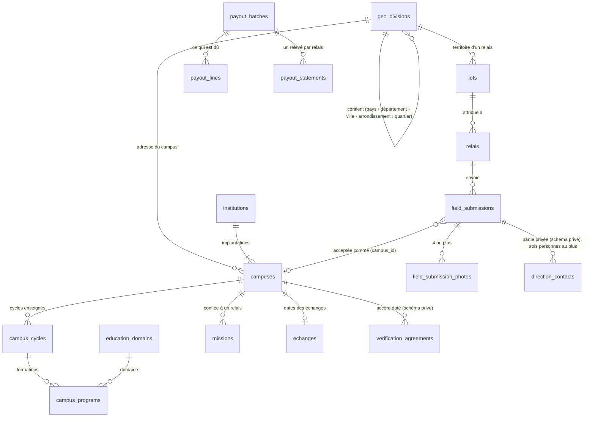

# Le schéma de la base

> **Version 2, du 02/11/2026** : le catalogue universel (plateforme pour tout le Congo, extensible à d'autres villes et d'autres pays). Les migrations (`supabase/migrations/`, 25 fichiers) **font foi** ; ce document en garde la carte et les raisons. La version 1 (une table `ecoles`, un `arrondissement` fixe) est reprise par les migrations `20261101200000` à `20261101201000` : les données d'avant se migrent sans perte (preuve plus bas).
>
> Structure **en anglais** (tables, colonnes, fonctions), vocabulaire **en français** : les ports (`src/modele/ports.ts`) et l'interface parlent français, seuls les adaptateurs de `src/infra/supabase/` traduisent. Les noms d'avant restent (`relais`, `lots`, `echanges`, `erreurs`, `prive`) : les renommer n'apporte rien et aurait risqué le lancement du 02/11 ; c'est faisable plus tard avec la même technique.

## Quatre principes

1. **Un relevé n'est pas l'école.** Ce qu'un relais envoie est un relevé (`field_submissions`) : une observation datée, signée, avec une position et des photos. L'école, c'est ce que l'administrateur a accepté (`accept_submission`). Un relais **n'écrit que dans `field_submissions`** (et, par fonction, ses photos et son contact) : jamais dans le catalogue, la géographie ou les lots. Les tests le vérifient.
2. **Le privé vit à part.** Les règles d'accès (RLS) filtrent des lignes, pas des colonnes : une colonne privée dans une table lisible finit par fuiter. Le contact de la direction, les accords, les numéros Mobile Money, les références d'import vivent dans le schéma `prive`, qu'**aucun rôle de l'API** ne lit : seules des fonctions `security definer` le touchent, après `exiger_admin_session()`.
3. **Portable.** Le cœur (`public` et `prive`) ne dépend de rien de Supabase : extensions de PostgreSQL (`postgis`, `pg_trgm`, `unaccent`, `ltree`), identité par `public.current_user_id()`, aucun objet `auth` ni `storage`. Ce qui est propre à Supabase est isolé dans `20261101200900_supabase_couche.sql`. Voir « Sortir de Supabase ».
4. **Aucune donnée inventée.** Les migrations ne portent que de la géographie administrative, avec sa source et la date où elle a été confrontée (`geo_divisions.source`, `verified_on`). Aucune école, aucun quartier, aucune position dans une migration : les écoles entrent par un relais ou par l'administration, et **sans position elles restent « à situer »**.

## La carte



## Les tables

| Table | Rôle | À retenir |
| --- | --- | --- |
| `geo_divisions` | La géographie, du pays au quartier, auto-référencée | `level` 0 pays · 1 département ou région · 2 ville, commune, district · 3 arrondissement · 4 quartier ou zone ; `kind` lié au niveau ; `path` (`ltree`) donne un sous-arbre en une comparaison ; `parent_level` et une clé étrangère composite garantissent que le niveau suit celui du parent ; `open_for_fieldwork` : la zone est ouverte aux relais (**faux partout sauf Tié-Tié et Ngoyo** ; ouvrir une zone ouvre tout ce qu'elle contient) ; **`public_status`** : l'état public sur la carte, `actif` (relevé en cours), `programme` (déploiement programmé) ou vide (non couverte), **distinct de `open_for_fieldwork`** (migration `20261103170000`, ticket #102) ; `position` : le point d'une ville, **toujours sourcé** (`position_source`, `position_verified_on` ; d'après OpenStreetMap : Pointe-Noire et Brazzaville depuis le 03/11, Kintélé, Oyo, Nkayi et Hinda depuis le 26/11) ; `boundary` (le contour, d'OpenStreetMap, simplifié : les six arrondissements de Pointe-Noire, **la commune de Brazzaville avec ses neuf arrondissements** depuis la migration `20261104010000`, ticket #113, et **le district de Hinda** (Kouilou) depuis `20261126100100`, ticket 232 ; `osm_relation` et `source` disent la relation et la date, la limite sud de la commune est la frontière au milieu du fleuve). Kintélé (département de Brazzaville, loi n° 29-2024), Oyo (Cuvette), Nkayi (Bouenza) et Hinda (Kouilou) entrent par `20261126100000` avec leur texte officiel ; ni Kintélé, ni Oyo, ni Nkayi n'ont de contour (OpenStreetMap n'a pas le bon), `aliases` (« Mvoumvou »), `source`, `verified_on` |
| `institutions` | « Complexe scolaire X », « Université Y » : un nom et un genre | `kind` = `type_ecole` ; une institution a un ou plusieurs campus |
| `campuses` | Une implantation physique | `slug` unique dans sa division (adresse publique) ; `position` (PostGIS) ; `publication` : `brouillon` → `prete` → `publiee` → `retiree` ; `origin` : `field` (relevée par un relais) · `admin` · `import` ; `verification_state` : `relevee` ou `verifiee`, et `verifiee` exige `verified_on` (l'accord daté de la direction) ; `replaced_by_campus_id` (fusion de doublons) |
| `campus_cycles` | Les cycles enseignés dans un campus | `cycle` = `niveau` (crèche → supérieur, autre formation), un par cycle |
| `campus_programs` | Les formations d'un cycle | `title` libre, `bac_track` (série), `diploma`, `domain_id`, `rhythms` ; `origin` ; `source_submission_id` ; un même titre n'entre qu'une fois dans un cycle |
| `education_domains` | Informatique, Gestion, BTP, Santé… | `parent_id` (arbre), `sort_order` ; l'administration en ajoute |
| `field_submissions` | Un relevé du terrain | `kind` : `releve` · `correction` · `contre_visite` ; position et précision ; `levels`, `school_kind`, `observed_programs` (séries ou filières vues, texte libre : un **indice** pour l'administration), `programs_photographed`, `observed_formations` (**ce que le relais a coché** : une liste `[{cycle, titre, serie, diplome, domaine}]`, la forme de `p_programs` de `accept_reviewed_submission` ; valeur par défaut `[]`, une liste d'au plus 80 éléments et 20 000 octets, **préremplit « À valider » sans rien publier** ; migration `20261109100000`) ; `duplicate_of_campus_id` et `duplicate_answer` ; `status` : `a_valider` · `a_corriger` · `accepte` · `refuse` ; `outside_batch` (plus de 50 m du lot : **une information**), `division_id` (la division la plus fine dont le contour contient la position), `in_open_zone` (cette division est ouverte aux relais ; **nul** quand aucun contour connu ne contient la position : « zone inconnue » n'est pas « hors zone ») et `possible_duplicate` (**calculés à l'arrivée par la base**, jamais par le téléphone) ; `payable` ; `trial_validated_at` (lot d'essai) |
| `field_submission_photos` | Les photos d'un relevé | **Une enseigne** (`signboard`, la seule obligatoire) **puis trois autres au plus** (`programs_board`, `brochure`, `building`) ; `storage_path` **relatif** (une contrainte refuse toute adresse de serveur) ; `bytes` ≤ 2 Mo (le téléphone envoie moins de 200 Ko) ; **privée tant que l'administration n'a pas vérifié « sans enfant ni donnée personnelle »** (`is_public` exige `child_free_checked_at`) |
| `missions` | Une école connue, confiée à un relais | `kind` : `verify` · `locate` · `complete` ; **une seule mission ouverte par campus** |
| `lots` | Le secteur conseillé d'un relais : un nom, une date, un objectif. **Jamais une barrière** : la limite du relais est la zone ouverte (ticket #67). Un relais peut n'avoir aucun lot | Sur **n'importe quelle** division (`geo_division_id`), contour facultatif ; `essai` : lot d'entraînement (ses fiches ne sont jamais publiées) ; **une zone fermée ne reçoit pas de lot** (sauf d'essai) |
| `relais` | Un relais (même identifiant que son compte) | `statut` : `en_attente` · `actif` · `suspendu` ; `lot_id` |
| `echanges` | Dates des échanges avec l'école | Premier message, réponse, relances : des dates, jamais le contenu |
| `erreurs` | Journal des erreurs de l'application relais | Écrit par le téléphone, lu par l'administration |
| `payout_rates` | Les tarifs, **datés** | Depuis le 01/11/2026 : 500 FCFA par fiche acceptée, +300 FCFA par contact confirmé, essai de 3 fiches validées = 1 500 FCFA. Un tarif change par une nouvelle ligne ; les anciens paiements gardent le leur |
| `payout_batches`, `payout_lines`, `payout_statements` | La paie du vendredi | Une clôture par vendredi ; une ligne par élément payé (**jamais deux fois** : unique par relevé et par nature, l'essai une seule fois par relais) ; un relevé par relais, « payé » avec la référence de l'opération |

Schéma `prive` (aucun droit pour l'API) : `relay_identity` (**l'adresse de connexion d'un relais**, pour que l'administration relie un compte à une personne ; ticket #78), `admins`, `direction_contacts` (**une ligne par personne à contacter, trois au plus par fiche** : fonction et sa précision si « autre », nom, WhatsApp, accord et sa date, source « relais » ou « administration » ; la première d'une fiche envoyée par un téléphone d'avant garde pour identifiant le numéro de la fiche ; ticket #96 ; **depuis le 16/11, une personne notée par l'administration peut appartenir au site sans fiche (`campus_id`), lue avec les autres par `contacts_of_campus`, ajoutée par `add_campus_contact`**), `verification_agreements` (l'accord daté de la direction pour « Vérifié » : la date et le canal, jamais le message), `relay_payment_details` (opérateur, numéro Mobile Money), `campus_sources` (la référence anonyme `ETB-…` d'un import), `erasures` (le journal du droit d'effacement : quoi, quand, par qui, sans le contenu).

### Les vues

| Vue | Pour qui | Ce qu'elle montre |
| --- | --- | --- |
| `public_campuses`, `public_campus_cycles`, `public_campus_programs` | Le site public (clé `publishable`) | Les seuls campus **publiés**, avec leur adresse (`division_slugs`, `division_names`), leurs cycles et leurs formations. Jamais le contact d'une personne, jamais une photo privée |
| `public_campus_redirects` | Le site public | Les anciennes adresses des doublons fusionnés, et la fiche gardée : le site les redirige |
| `submissions_to_review` | L'administration | Les relevés à valider, avec ce qu'il faut pour décider |
| `relay_counters` | L'administration | Par relais : envoyées, à valider, à corriger, acceptées, refusées, contacts confirmés |
| `division_stats` | L'administration | Par zone : écoles, publiées, relevées / ajoutées / importées (**les écoles amorcées ne gonflent jamais « relevées par un relais »**) |

### Les adresses publiques

`ntanova.com/ecoles/<pays>/<département-ou-ville>/<arrondissement>/<quartier>/<campus>/`. Pointe-Noire est à la fois un département et une ville (deux lignes de même nom, l'une sous l'autre) : l'adresse saute la répétition. Deux règles de la base (`20261101201000`) : **une adresse n'a qu'un propriétaire** (la page d'une zone ou la fiche d'un campus, jamais les deux sous une même division), et `unique_campus_slug` ajoute `-2`, `-3`… quand une adresse est prise. Quand une fiche est fusionnée avec une autre, l'ancienne adresse **renvoie** vers la gardée (`public_campus_redirects`).

## Les fonctions

Les paramètres portent le préfixe `p_`, les variables locales `v_` (sauf `activer_relais(relais, lot)`, héritée de la version 1). Chaque fonction qui touche `prive` est `security definer` et commence par `exiger_admin_session()` : le rôle courant y est le propriétaire, on regarde donc le jeton, la personne connectée et le rôle pris par `set role`.

| Pour | Fonctions |
| --- | --- |
| Le relais (téléphone) | `my_batch()` (son lot) · `known_places_for_me()` (les écoles connues de **toutes les zones ouvertes**, plus de son secteur s'il en a un, pour l'alerte à 40 m **sans réseau**, où qu'il soit ; `known_places_in_my_batch()`, qui ne couvrait que le lot, reste en place pour les téléphones déjà installés et sera retirée par une migration ultérieure) · `my_missions()` (les écoles qu'on lui confie, avec ce que NTanova en sait : position, état de vérification, **photos par rôle sans leur chemin**, contact de la direction confirmé ou non) · `my_submissions()` (**ses** fiches, avec tout ce qu'elles contiennent, la décision de NTanova, les photos par rôle, et « le contact est arrivé » sans le lire : de quoi préremplir « Compléter » et « Corriger » ; migration `20261102100000`, ticket #55 ; `observed_formations` ajouté le 09/11/2026 par `20261109100000`, qui refait la fonction avec les mêmes droits) · `my_submission_photos(p_submission)` (**les photos d'UNE de ses fiches** : identifiant, rôle, chemin relatif ; rien pour la fiche d'un autre ni pour un relais inactif ; avec la règle du seau « le relais actif relit les photos de ses relevés », elle laisse le relais **revoir ce que NTanova a reçu** quand il corrige une fiche ; migrations `20261103100000` et `20261103100100`, ticket #72) · `register_photo(…)` (enregistre une photo reçue ; répond « déjà reçu » à un envoi rejoué) · `send_contact(…)` · `contact_received(p_submission)` (« le contact est arrivé », sans le lire ; `send_contact` prend en plus `p_contact` et `p_role_detail` : une personne de plus, rejouable sans doublon) |
| Décider d'un relevé | `accept_submission(p_submission, p_mode, p_campus, p_institution, p_label, p_programs, p_division)` : **en un geste** (**une correction d'une fiche pas encore acceptée reprend la position, puis le secteur, de la fiche d'origine** : migration `20261103120000`, ticket #89), `new_institution` · `new_campus` · `update_campus` · `add_cycle`, avec les formations lues sur les photos · `request_correction` · `refuse_submission` (un refus est définitif ; **avec le motif `autre`, le message est obligatoire** : migration `20261103110000`, ticket #80) · `contact_of_submission` · `confirm_contact` (la fonction confirmée débloque le +300 FCFA ; pas le secrétariat) · `validate_trial_submission` (lot d'essai : compte pour la paie, ne publie jamais) · **`p_division`** (facultatif) : la division de l'école, choisie par l'administration ; elle l'emporte sur celle de la position, et elle est **obligatoire quand aucun contour connu ne contient la position** : la fiche ne retombe plus sur la division du lot du relais (ticket #67). Sans position, la division du lot reste le repli |
| Amorcer sans relais | `create_catalog_entry(p_entry)` (une école d'un coup : institution, campus, cycles, formations) · `import_catalog(p_entries, p_dry_run)` (une liste, **simulation d'abord** : rien n'est écrit tant que `p_dry_run` est vrai ; rejouable sans doublon grâce à la référence ; ticket 205 : une formation peut dire `duration_years`, `admission_level` et `declared_on`, le jour où l'école l'a dit, obligatoire dès qu'un détail est donné) |
| Le catalogue | `publish_campus` · `publish_division` · `publish_batch` · `retire_campus` (avec motif) · `merge_campuses(p_duplicate, p_kept)` · `locate_campus` (position prise par l'administration : jamais inventée) · `upsert_programs` · `record_verification` (l'accord daté, badge « Vérifié ») · `erase_contact` (toutes les personnes d'une fiche) · `erase_contact_person` (une seule) · `add_contact` · `update_contact` (l'administration note et corrige une personne) · `erase_photo` · `trash_campus(p_campus, p_reason, p_note)` · `restore_campus` · `campus_purge_preview` (ce que la suppression emporterait, et ce qui la bloque) · `purge_campus` (suppression définitive, après la corbeille) · `set_campus_public_photo(p_campus, p_photo, p_confirmed)` (la photo publique : choix prioritaire, ou **retrait explicite** avec une photo nulle) · `campus_public_photo_state(p_campus)` (lecture seule : `automatique`, `choix` ou `retire`, le choix et la photo retenue) |
| Les zones et les lots | `set_division_open` · `set_division_public_status(p_division, p_status)` (administration seule : l'état public d'une zone, `null` la retire de la carte ; ne touche jamais à `open_for_fieldwork`) · `create_lot` · `mark_batch_returned(p_batch, p_returned)` (un lot est **rendu** quand l'administration le déclare terminé : `lots.rendu_le`) · `activer_relais` · `assign_mission` · `cancel_mission` |
| La vue d'ensemble | **`admin_overview(p_days)`** (ticket #76 ; migration `20261103110100`) : un appel, des agrégats en JSON, **administration seule, lecture seule, aucun seuil** : fiches à valider (nombre, plus ancienne, plus de 24 h), relevés par jour (le lot d'essai à part, jours à l'heure de Pointe-Noire), délai de décision et photos d'enseigne sur 30 jours, contacts confirmés, relais par statut et relais qui ont envoyé une fiche cette semaine (**`relais.active_le` est la date d'activation, jamais une activité**). Les écoles par zone viennent de `division_stats` / `divisions()`. |
| La paie | `payout_preview(p_friday)` (ce qui est dû, sans rien écrire) · `close_payout_week(p_friday)` (un vendredi, une fois) · `payout_statements_of` · `mark_statement_paid(p_batch, p_relay, p_reference)` · `set_relay_payment_details` · `payable_items(p_friday)` (le calcul brut, administration seule) · **`my_payout(p_friday)`** (le relais lit **sa** paie : l'acquis du prochain vendredi, puis les semaines closes « à payer » ou « payées » avec la référence ; jamais le numéro Mobile Money, seulement si NTanova l'a ; migration `20261102110000`, ticket #55) |

> **Un seul calcul de la paie.** `payable_items` (administration) et `my_payout` (relais) appellent la même fonction privée `prive.payable_items_for(p_friday)` : les montants que le relais lit sont ceux de l'administration, par construction (`supabase/tests/ma_paie.test.sql` le vérifie). Cette fonction n'est exécutable par aucun rôle de l'API.
| Chercher | `search_campuses(…)` : nom, repère, cycle, série, diplôme, domaine, rythme, zone, distance. **Les critères de formation portent sur UNE MÊME formation** (« série C » et « soir » = une formation du soir en série C). `f` et `g` trouvent aussi F1 à F4 et G1 à G3 |
| Outils | `current_user_id()` · `est_admin()` · `exiger_admin()` · `exiger_admin_session()` · `norm_text()` (minuscules sans accents, indexable) · `slugifier()` · `division_of_position()` · `is_open_for_fieldwork()` · `register_relay()` (à la première connexion ; aucun rôle de l'API ; **la version à quatre paramètres garde l'adresse du compte dans `prive.relay_identity`**, nettoyée ; l'appel à trois paramètres marche toujours) · `relay_identities()` (les adresses, **administration seule**, ticket #78) |
| Maintenance (schéma `prive`, aucun rôle de l'API) | `prive.attach_submissions_to_fine_lots(p_division)` · `prive.lot_problems(p_division)` |

## Les droits

Tout est d'abord **retiré**, puis donné table par table (`20261101200800`) : en local Supabase donne tout aux nouvelles tables, en ligne rien ; ainsi les deux bases ont exactement les mêmes droits.

- **`anon` (un visiteur)** : lit les vues `public_*`, `geo_divisions`, `education_domains` et les campus **publiés** (par RLS). Rien d'autre.
- **`authenticated` (un relais)** : écrit `field_submissions` **colonne par colonne** (ce que remplit le téléphone ; jamais le statut, l'auteur, la paie, `campus_id`, `outside_batch`) ; lit ses relevés, son profil et ses missions ; appelle les fonctions du terrain. Ne lit **aucun** contact, même le sien.
- **L'administration** (`prive.admins`) : les mêmes jetons, des règles de plus : elle lit tout le terrain, écrit le catalogue, les zones, les lots, les tarifs ; ses fonctions refusent tout autre appel.
- **Jamais de suppression directe** d'une institution, d'un campus ni d'un relevé par l'API (aucun `delete` accordé) : on retire (`retire_campus`), on fusionne, on efface un contact ou une photo par leur fonction, qui garde la trace de l'effacement. **Depuis le 06/11/2026, une école se supprime pour de bon, mais seulement en trois temps et par fonction** : `trash_campus` (corbeille : l'école quitte les listes, le site, les statistiques et les missions, reste récupérable par `restore_campus`), puis `purge_campus` (administration seule, `security definer`) qui emporte l'école, ses fiches, ses photos, ses contacts, ses frais, ses faits et son historique, et laisse une ligne dans `prive.erasures` (`what = 'campus'`, le nom et les nombres, jamais un contact). `purge_campus` **refuse** si l'école n'est pas à la corbeille, si une de ses fiches figure dans la paie (`payout_lines`), si un envoi en attente la concerne ou si une fusion y renvoie. Les fichiers du stockage partent d'abord, côté client, avec les chemins que `campus_purge_preview` rend (comme `erase_photo`).

## Corriger une nouvelle école avant l’acceptation

Dans « À valider », « Corriger avant d’accepter » prépare le nom, le type, les niveaux, le programme, le repère ou le numéro public. « Utiliser ces valeurs » reste local : seule l’acceptation enregistre. Les champs et leurs contrôles sont partagés avec l’onglet « Écoles » ; une implantation déjà connue se modifie depuis cet onglet.

`accept_reviewed_submission` reprend les paramètres de `accept_submission`, plus `p_changes` (les champs de relevé explicitement corrigés). Les valeurs corrigées servent à créer l’institution et son campus, dans la même transaction que la décision. Le relevé du relais reste intact, ainsi que sa position, sa date et ses photos. `submission_reviews` garde les valeurs retenues, `reviewed_by` et `reviewed_at`, fournis par le serveur : lecture et insertion réservées à l’administration, aucune réécriture. La suppression du relevé efface aussi cette trace. La révision se relit dans « Décidées » avec l’original.

**La position saisie à l’acceptation** (ticket 144, migration `20261107150000`) : `accept_reviewed_submission` reçoit aussi `p_latitude` et `p_longitude` (nuls par défaut ; les deux ensemble, dans les bornes de la Terre). Quand le téléphone du relais n’a pas pu mesurer la position, l’administration la lit sur une carte et la saisit sur la fiche « À valider » : la nouvelle école ou implantation naît avec elle, `located_by` et `located_at` disent qui l’a posée et quand (« jamais de position inventée »), et la division est celle du contour qui la contient, sinon celle que l’administration choisit (`p_division`, comme pour une position du relais). **Une position saisie ne remplace jamais celle du relais** (ou de la fiche d’origine d’une correction) et ne s’ajoute pas à de simples niveaux (`add_cycle`). Pour une école connue (`update_campus`), la décision passe par `locate_campus` : école retirée refusée, adresse publique protégée, division détectée ou choisie ; une école vérifiée par la direction ne se déplace pas par un relevé. Le relevé du relais reste intact ; la position saisie est gardée dans `submission_reviews.changes` (clé `position`), et le champ est refusé dans `p_changes` (une correction ne peut pas inventer la position).

L’ancien appel sans corrections reste disponible et délègue au même moteur. Une répétition renvoie le campus déjà accepté sans modifier la révision. Une erreur annule toute la décision. Accepter ne publie jamais automatiquement.

**Mise en ligne : appliquer `20261105120000_corrections_avant_acceptation.sql` avant le code.** Aucun changement de base du téléphone, de file d’envoi ou de règle de paie.

## Les listes (types, niveaux…) : des listes qui ne bloquent personne

Les listes fermées sont des **domaines SQL**, copiés dans `src/modele/listes.ts` (un test vérifie qu'ils restent identiques, même ordre). Règles, pour **toute liste fermée** d'un écran relais ou administration :

- **Une case de sortie**, toujours : `autre` (c'est écrit, mais ça ne rentre dans aucune case) et `non_indique` (rien n'est écrit). Rien n'est obligatoire pour envoyer une fiche, et rien n'est coché d'avance si cela fausse la donnée.
- **Un texte libre facultatif** capte ce que la liste ne sait pas encore (`curriculum_note`, le `title` d'une formation).
- **On ne retire et on ne renomme jamais une valeur.** Pour changer un mot, on change le libellé. Un test refuse qu'une migration retire une valeur.
- **Les lectures sont tolérantes** : une valeur que le code ne connaît pas encore (`typeConnu`, `niveauxConnus`) se lit « Pas indiqué » ou se laisse de côté, jamais d'erreur.

| Liste | Valeurs |
| --- | --- |
| `type_ecole` | publique · privee · confessionnelle · communautaire · autre · non_indique |
| `niveau` | creche · maternelle · primaire · college · lycee · technique · superieur · autre_formation |
| `geo_kind` | country · department · region · city · commune · district · arrondissement · quarter · zone |
| `bac_track` | a · c · d · e · f · f1 · f2 · f3 · f4 · g · g1 · g2 · g3 · h · autre |
| `diploma_kind` | cepe · bepc · bac · bt · bts · licence · master · doctorat · cap · certificat · autre |
| `study_rhythm` | jour · soir · weekend |
| `photo_role` | signboard · programs_board · brochure · building |
| `origin_kind` | field · admin · import |
| `mission_kind`, `mission_status` | verify · locate · complete, et open · done · cancelled |
| Les autres (`fonction_direction`, `motif_decision` (dont `position_imprecise`, qui remplace `hors_lot` dans ce que l'administration propose ; `hors_lot` reste pour relire), `statut_releve`, `type_releve`, `statut_relais`, `direction_vue`, `reponse_doublon`, `etat_ecole`, `publication`, `motif_retrait`, `type_echange`) | Voir `src/modele/listes.ts` |

### La recette : ajouter une valeur à une liste

1. **Une migration** : `alter domain public.<liste> drop constraint <liste>_check;` puis `alter domain public.<liste> add constraint <liste>_check check (value in (…)) not valid;`. **`not valid` est obligatoire** : `levels` est une colonne en tableau (`niveau[]`), que PostgreSQL ne sait pas revalider. Sans danger : élargir une liste n'invalide aucune ligne. Ne jamais lancer `validate constraint`.
2. **`src/modele/listes.ts`** : la valeur, dans le même ordre que la migration.
3. **`src/modele/libelles.ts`** : son mot.
4. **`pnpm verif`** : le test des listes compare le code et les migrations ; celui des libellés vérifie que chaque valeur a son mot.
5. **`pnpm exec supabase db push` AVANT la mise en ligne** du code qui la propose : sinon un téléphone enverrait une valeur que la base refuse.

## Les lots fins

Un lot a un contour facultatif : sans contour, il couvre toute sa division. Une division ouverte peut être coupée en lots plus fins, pour qu'un relais ait un territoire qu'il couvre en quelques jours et que « hors du lot » ait un sens.

- **Les limites sont une décision du fondateur** : des lignes tracées sur une carte, de préférence le long d'avenues. Les lots fins sont des **secteurs conseillés** (décision du 02/11 : le secteur reste l'unité de la mesure de complétude) ; ils se tracent après les premiers jours de relevé réel.
- **On coupe dans la base** : une migration de données coupe le contour avec `ST_Split` (aucun trou ni recouvrement, par construction), insère les lots, puis appelle `prive.attach_submissions_to_fine_lots('<division>')`. On vérifie avec `select * from prive.lot_problems('<division>')` : aucune ligne, rien à signaler (trous, recouvrements, débordements au-dessus de 1 000 m²).
- **« Hors du lot » : à plus de 50 m du contour**, une **information** calculée par la base à l'arrivée du relevé (`outside_batch`) ; le rattachement la recalcule. Le téléphone ne la calcule plus (ticket #67) : un secteur est un conseil, pas une limite. Ni le refus d'une fiche ni la paie ne la lisent ; l'administration voit plutôt `in_open_zone` (« Hors zone ouverte » ou « Zone inconnue », en information).

## Sortir de Supabase

**Prouvé** (`supabase/portabilite/banc.sh verifier`, rejoué le 02/11/2026) : les 25 migrations se rejouent sur un PostgreSQL 16 + PostGIS jetable ; les 425 tests pgTAP passent ; un `pg_dump` des schémas `public` et `prive` se restaure sur un PostgreSQL **ordinaire** (aucun objet `auth` ni `storage`) où 403 tests « cœur » passent encore ; la migration des données de la version 1 conserve identifiants, adresses, statuts, contacts et missions (29 contrôles). **Non éprouvé** : l'API et les fichiers sur un autre serveur (ci-dessous).

### Le conteneur à soi, pas à pas

```bash
# 1. Exporter les deux schémas (depuis Supabase, ou tout autre PostgreSQL)
pg_dump "$URL_DE_LA_BASE" --schema=public --schema=prive --no-owner --format=plain \
  --quote-all-identifiers > ntanova.sql

# 2. Un PostgreSQL avec PostGIS (sur un Mac à puce Apple, `postgis/postgis` n'existe pas en arm64 : une image
#    multi-architecture comme `imresamu/postgis:17-3.5-bookworm` fait la même chose)
docker run -d --name ntanova-pg -e POSTGRES_PASSWORD=… -p 5432:5432 postgis/postgis:17-3.5

# 2 bis. Une base NEUVE, sans rien dedans : l'image installe déjà PostGIS dans la base `postgres`, et l'étape 3
#        (qui le range dans `extensions`) y échouerait.
psql -h 127.0.0.1 -U postgres -c "create database ntanova template template0"
```

```sql
-- 3. Préparer la base `ntanova` : les extensions natives, les rôles de l'API et de la plateforme, un schéma public vide
create schema extensions;
create extension postgis  with schema extensions;
create extension pg_trgm  with schema extensions;
create extension unaccent with schema extensions;
create extension ltree    with schema extensions;
create extension pgcrypto with schema extensions;   -- le sceau des envois (lot 3B1)
create role anon          nologin noinherit;
create role authenticated nologin noinherit;
create role service_role  nologin noinherit;   -- nommé dans les droits d'un export fait depuis Supabase
create role supabase_admin nologin;                -- nommé dans les `ALTER DEFAULT PRIVILEGES` d'un export fait depuis Supabase
grant usage on schema extensions to anon, authenticated;
alter database ntanova set search_path = "$user", public, extensions;
drop schema public cascade;   -- celui d'une base neuve est vide : l'export le recrée avec tout son contenu
```

```bash
# 4. Restaurer
psql "$URL_DU_CONTENEUR/ntanova" -f ntanova.sql
```

- **Les rôles de la plateforme** : un export fait depuis Supabase nomme `service_role` dans les droits de ses objets, et peut nommer `postgres` ou `supabase_admin` dans des lignes `ALTER DEFAULT PRIVILEGES`. Créez ces rôles (sans connexion) avant de restaurer, ou retirez ces lignes de `ntanova.sql`. **Éprouvé le 03/11/2026 avec un vrai dump** (celui de la base locale de Supabase, pas un simulacre) restauré dans un PostgreSQL 17 + PostGIS ordinaire : **0 erreur** avec les quatre rôles ci-dessus, comptes identiques sur les 23 tables des deux schémas. Sans le rôle `supabase_admin`, 7 lignes `ALTER DEFAULT PRIVILEGES` échouent (sans conséquence pour les données).
- **L'API** : un PostgREST (`PGRST_DB_SCHEMAS=public`, `PGRST_DB_ANON_ROLE=anon`) devant la base. L'identité d'une requête est celle de son jeton : `public.current_user_id()` lit `request.jwt.claims` (ou `request.jwt.claim.sub`), comme le font PostgREST et Supabase, avec un rôle `authenticated` ou `anon`. La pile Supabase auto-hébergée (Docker) convient telle quelle ; un autre serveur demande de remplacer `src/infra/supabase/` par un adaptateur du même port (`src/modele/ports.ts` ne change pas).
- **Les comptes** : tout serveur d'identité appelle `public.register_relay(id, google_sub, prénom)` à la première connexion ; l'administrateur s'inscrit dans `prive.admins`.
- **Les photos** : la base ne garde qu'un chemin relatif (`field_submission_photos.storage_path`, par exemple `<relevé>/<photo>.webp`) ; une contrainte refuse tout ce qui ressemble à une adresse de serveur. Le fichier va dans le stockage de son choix (S3, MinIO, un dossier), au même chemin. Le seau `releves` et ses règles sont dans la couche Supabase, qu'on remplace. Le relais relit les fichiers de **ses** relevés (le dossier du fichier est un de ses relevés), jamais ceux d'un autre ; il lit leur chemin par `my_submission_photos`, jamais la table des photos.
- **Ce qui est propre à Supabase** (le déclencheur sur `auth.users`, le seau et ses règles) tient dans une migration, `20261101200900_supabase_couche.sql`, dont chaque instruction est gardée : sur un PostgreSQL sans `auth` ni `storage`, elle ne fait rien. De même la planification de la purge des messages, `20261124140400_messages_supabase_couche.sql` : sans `pg_cron`, un ordonnanceur (cron, systemd) appelle chaque jour `select prive.purge_public_requests()`.

## Sauvegarder et restaurer (ticket #81)

Le plan gratuit de Supabase **ne sauvegarde rien**. `.github/workflows/sauvegarde.yml` fait chaque nuit (2 h 30 UTC, et à la main) **une copie chiffrée** de la base et des photos, hors de Supabase : `outils/sauvegarder-la-base.sh` écrit `sauvegarde-AAAA-MM-JJ.tar.gz.age`, conservé **30 jours** comme artefact privé du dépôt. Le fichier contient le dump des schémas `public` et `prive` (PostgreSQL 17, donc des contacts de directions et des numéros Mobile Money), la liste des photos et les photos : **il est chiffré** pour une clé publique `age` ; la clé privée reste chez le fondateur, **hors du dépôt, hors du Mac si possible** (un gestionnaire de mots de passe et une copie hors ligne). **Sans elle, aucune sauvegarde ne se relit.** Le script refuse un dump trop petit, sans les tables attendues, ou dont des photos manquent : la nuit passe alors en rouge et GitHub écrit au fondateur.

### La mise en place, une fois (par le fondateur : les valeurs ne passent jamais par une conversation)

```bash
# 1. La paire de clés : la privée reste chez toi, hors du dépôt (brew install age)
age-keygen -o cle-privee-ntanova.txt        # affiche « Public key: age1… »
gh secret set SAUVEGARDE_CLE_PUBLIQUE --repo benaja-bendo/ntanova-site --body "age1…"

# 2. La connexion à la base : Supabase › Connect › « Session pooler » (IPv4, port 5432, utilisateur postgres.<projet>),
#    avec le mot de passe de la base. La connexion directe est en IPv6 : les exécuteurs de GitHub ne l'atteignent pas.
gh secret set SAUVEGARDE_DB_URL --repo benaja-bendo/ntanova-site          # colle la chaîne à l'invite

# 3. Les photos : l'adresse du projet et UNE CLÉ SECRÈTE dédiée (Supabase › Project Settings › API Keys › Secret keys,
#    nommée « sauvegarde » : elle se révoque seule). Jamais l'ancienne `service_role` (ticket #28 : on la coupe).
gh secret set SUPABASE_URL --repo benaja-bendo/ntanova-site               # https://<projet>.supabase.co
gh secret set SUPABASE_SECRET_KEY --repo benaja-bendo/ntanova-site        # colle sb_secret_… à l'invite
```

Puis **un lancement à la main** (GitHub › Actions › Sauvegarde › Run workflow) : c'est la seule preuve que la connexion et la clé marchent en ligne. Tant qu'un des quatre secrets manque, la nuit échoue, avec le nom du secret manquant.

### Restaurer

```bash
# 1. Télécharger l'artefact (GitHub › Actions › la dernière sauvegarde), puis le déchiffrer et l'ouvrir
age -d -i cle-privee-ntanova.txt sauvegarde-AAAA-MM-JJ.tar.gz.age | tar xz     # base.sql, photos.txt, photos/

# 2. La base : voir « Le conteneur à soi, pas à pas » plus haut (étapes 2 à 4, avec base.sql à la place de ntanova.sql)

# 3. Les photos : une par ligne de photos.txt, au même chemin, dans le seau `releves` du nouveau stockage
while IFS= read -r chemin; do
  curl -fsS -X POST "$SUPABASE_URL/storage/v1/object/releves/$chemin" -H "apikey: $SUPABASE_SECRET_KEY" \
    -H "Content-Type: image/webp" --data-binary @"photos/$chemin"     # image/jpeg pour une photo .jpg
done < photos.txt
```

**Essayé le 03/11/2026** (script contre la pile locale de Supabase) : la clé secrète `sb_secret_…` est acceptée **dans `apikey` seul** pour lire les photos ; l'archive ne se lit qu'avec la clé privée ; la base se restaure sans erreur dans un PostgreSQL 17 + PostGIS ordinaire, avec des comptes identiques sur les 23 tables ; une photo effacée du stockage revient **identique à l'octet près**. **Pas encore essayé** : une exécution sur GitHub (la connexion par le pooleur, la clé acceptée par la passerelle en ligne) ; le premier lancement à la main, après les secrets, le prouve.

### Restaurer sans faire réapparaître une information retirée (procédure manuelle, 24/11/2026)

Une sauvegarde ramène ce qui avait été retiré après elle (un numéro, une photo, une fiche), des messages déjà purgés, et l'ancien secret d'envoi. **Rien ne le détecte** : c'est le fondateur qui suit ces étapes, dans l'ordre, et les note. Aucune référence reçue par e-mail ne dit ce qu'il faut retirer. Tant que l'étape 6 n'est pas faite, **aucune mise en ligne**.

1. **Suspendre la construction** avant toute restauration réelle, la planifiée du lundi comprise, et ne pas toucher au site en ligne : il reste la dernière version publique connue.

   ```bash
   gh workflow disable mise-en-ligne.yml --repo benaja-bendo/ntanova-site
   ```

   Garder aussi sa dernière construction (l'artefact `site` de la dernière mise en ligne, 7 jours) : elle dit ce qui était public si le site ne se lit plus.
2. **Restaurer en isolation** : dans le conteneur à soi (étapes 1 à 4 de « Le conteneur à soi »), jamais directement dans la base que le site lit.
3. **Sortir toutes les fiches de la publication**, puis purger et fermer les envois (les laissez-passer d'avant la perte cessent de valoir) :

   ```sql
   update public.campuses set publication = 'prete' where publication = 'publiee';
   select prive.purge_public_requests();
   delete from prive.public_request_secrets;   -- fermés ; rouvrir à la fin, étape 7
   ```

4. **Comparer, fiche par fiche**, la base restaurée à la dernière version publique (le site en ligne, sinon l'artefact) : numéro affiché, contact public, photos, nom, fiche entière. Ce que la base montre et que le site ne montre plus est un retrait ou une correction à refaire, dans Écoles. Rejouer aussi les retraits connus : `select * from prive.erasures order by at desc` (jusqu'à la date de la sauvegarde), et les demandes de retrait ouvertes (`select * from public.list_public_requests('retraits')`).
5. **Republier une fiche seulement une fois vérifiée** (« Publier », dans Écoles). Sans version publique lisible ni journal exploitable : chaque fiche reste hors publication jusqu'à sa relecture.
6. **Noter** dans le registre : la date de la sauvegarde, qui a vérifié, combien de fiches, ce qui a été refait. Puis l'ordre de remise en ligne, écrit.
7. **Sur Supabase**, rejouer la couche que la copie n'emporte pas (`supabase_layer`, seau, planifications) : `20261101200900_supabase_couche.sql`, les migrations `*_supabase_couche*` et `20261124140400_messages_supabase_couche.sql` puis `20261124150100_messages_alerte_supabase.sql`, qui se rejouent sans doublon ; reposer les secrets du service d'annonce s'il existe. Rouvrir : `gh workflow enable mise-en-ligne.yml`. Les formulaires, en dernier, avec un secret neuf : `select prive.renew_public_request_secret(p_revoke => true);`.

Les personnes qui ont écrit entre la sauvegarde et la perte ne sont plus connues : le fondateur communique lui-même, aucun bandeau ne se publie seul. **Essayé le 24/11/2026 sur des données inventées** (banc PostgreSQL 16 jetable, `pg_dump` des deux schémas) : sans la procédure le numéro retiré réapparaît et l'ancien laissez-passer vaut encore ; avec elle, non. **Pas essayé** : un artefact réel de GitHub avec la clé privée du fondateur.

**Limites** : une copie par nuit (on peut perdre jusqu'à 24 heures de relevés) ; pas de restauration à un instant précis ; trente jours d'historique. Le plan Pro de Supabase (sauvegardes quotidiennes gérées) reste la solution propre quand l'argent entre ; cette copie, elle, se restaure sur n'importe quel PostgreSQL.

### Le ménage des durées (à la main, en janvier et en juillet)

Confidentialité dit combien de temps chaque donnée est gardée (durées acceptées par le fondateur le 25/11/2026) et qu'un ménage est fait **deux fois par an**. Rien ne l'automatise, sauf les messages des formulaires (`prive.purge_public_requests()`). Un ménage sauté rend la page fausse. Faire d'abord la sauvegarde du jour. Premier ménage : janvier 2027 (le journal technique seul) ; les photos et les demandes n'arrivent à leur terme qu'à partir de novembre 2027.

Regarder, sans rien effacer (éditeur SQL) :

```sql
select 'journal technique' as quoi, count(*) from public.erreurs
 where recu_le < now() - interval '3 months'
union all
select 'demandes de vérification', count(*) from public.family_demands
 where created_at < now() - interval '12 months'
union all
select 'fiches retirées', count(*) from public.campuses
 where publication = 'retiree' and replaced_by_campus_id is null
   and retired_at < now() - interval '12 months'
union all
select 'photos non publiées', count(*) from public.field_submission_photos p
 where p.received_at < now() - interval '12 months' and not p.is_public
   and not exists (select 1 from public.campus_media m where m.source_photo_id = p.id)
   and not exists (select 1 from prive.campus_photo_choices h where h.photo_id = p.id)
union all
select 'relais partis', count(*) from public.relais r
  join prive.relay_identity i on i.relay_id = r.id
 where coalesce((select max(s.received_at) from public.field_submissions s where s.relay_id = r.id), r.cree_le)
       < now() - interval '12 months';
```

Effacer, une fois les nombres relus :

1. **Journal et demandes** : `delete from public.erreurs where recu_le < now() - interval '3 months';` puis `delete from public.family_demands where created_at < now() - interval '12 months';`
2. **Fiches retirées** : administration, corbeille puis suppression définitive (`trash_campus`, `purge_campus`), qui emporte ses photos et ses contacts.
3. **Photos non publiées** : `erase_photo` puis le fichier du stockage, une photo à la fois. Ne jamais effacer une photo dont une image publiée est tirée (`campus_media.source_photo_id` est en cascade : l'image publiée partirait avec elle) ; la requête ci-dessus les écarte.
4. **Relais partis** : pour chacun, `delete from prive.relay_identity where relay_id = '…';` et `update public.relais set prenom = 'Relais parti', google_sub = null, statut = 'suspendu' where id = '…';`, puis son compte dans Authentication. **La paie reste dix ans** (`payout_*`, `prive.relay_payment_details`) : ne pas supprimer la ligne de `relais`.
5. **WhatsApp et boîte de courrier** : les échanges dont le dernier message a plus de douze mois. L'accord d'une école y est peut-être écrit : la base n'en garde que la date et le canal.

## Les tests

- **`pnpm base:tests`** (pgTAP, `supabase/tests/`, Docker et Supabase CLI) : **425 vérifications** en 12 fichiers (droits, géographie, catalogue, terrain, décisions de l'administration, import, lots, paie, recherche, adresses, portabilité, couche Supabase). Les droits sont éprouvés des deux côtés : en donnant à tort un droit à un relais, les tests échouent.
- **`supabase/portabilite/banc.sh`** : la même chose sans Docker (PostgreSQL 16 jetable et une couche de compatibilité, `shim-supabase.sql`, qui n'entre jamais dans une migration) ; `verifier` enchaîne rejeu, tests, export, restauration sur base nue, tests « cœur » et migration de données.
- **`tests/unitaires/contrat-schema.test.ts`** : tout ce que l'adaptateur appelle (fonctions et paramètres, tables, vues, colonnes, liens entre tables, seaux) existe dans les migrations. Les parcours de bout en bout tournent sur un faux serveur : sans ce test, une faute de frappe dans un nom de colonne ne se verrait qu'en production.

## Voir le schéma en local

1. `pnpm base:demarrer` (Docker), puis `pnpm base:reset` pour rejouer les migrations.
2. Supabase Studio : http://127.0.0.1:54323, menu **Database**, puis **Schema Visualizer** (schémas `public` et `prive`).

## Le premier jour en ligne

Les migrations s'appliquent **depuis le Mac du fondateur, après relecture, jamais depuis la CI**, et **avant** la mise en ligne du code (jamais l'inverse), après une sauvegarde de la base.

> **Attention, la version 2 renomme et retire des tables et des fonctions, sans couche de compatibilité.** Entre `db push` et le déploiement du nouveau code, l'application relais en ligne ne peut plus envoyer (ses fiches attendent dans le téléphone et partent après la mise à jour) et l'administration en ligne ne marche plus. Faire `db push` et la mise en ligne **à la suite**, de nuit, puis ouvrir `essai.ntanova.com` tout de suite après. Un essai à blanc : restaurer une sauvegarde de la base en ligne dans le banc (`supabase/portabilite/banc.sh`) et y rejouer les migrations.

1. Relire les migrations, puis `pnpm exec supabase db push` (le mot de passe de la base est demandé).
2. Te connecter une première fois avec Google sur le site d'essai : la base crée ta ligne de relais, en attente (`register_relay`).
3. Dans l'éditeur SQL de Supabase Studio, t'inscrire comme administrateur :

   ```sql
   insert into prive.admins (id) select id from auth.users where email = '<ton adresse>';
   ```

4. Pour chaque relais, après sa première connexion : dans l'administration (`/admin/`, onglet « Relais »), choisir son lot puis « Activer ». Ouvrir une zone aux relais : onglet « Zones » (`set_division_open`).
5. Une migration qui change l'adresse publique d'une fiche garde un renvoi de l'ancienne adresse (`public_campus_redirects`) : les liens déjà partagés continuent de marcher.

## Plus tard

| Quoi | Quand |
| --- | --- |
| Une source à citer pour les subdivisions des villes autres que Brazzaville et Pointe-Noire (leurs lignes portent `verified_on` vide en attendant) | Avant d'afficher ces zones comme « vérifiées » |
| L'accord parental d'un relais mineur (la proposition technique du 30/10 le prévoyait ; il n'est pas encore dans la base) | Avant d'accueillir des relais mineurs |
| Les photos publiques : `is_public` existe, mais le site n'affiche encore aucune photo | Avec la fiche vérifiée |

## Contact public de l’école — 04/11/2026, ticket 104

Migration `20261104170000_contact_public_ecole.sql` : `campuses.public_phone` et `public_phone_agreed_on`, indissociables, ajoutés à la fin de `public_campuses`. La RLS existante ne montre que les campus publiés. Aucun numéro privé ou d’enseigne n’est copié automatiquement.

`set_school_public_contact(p_campus, p_phone, p_agreed_on, p_role, p_channel)` exige une session administrateur. Numéro et accord complet (date réelle non future, fonction et canal) sont obligatoires. Tous les paramètres d’accord à `null` retirent le contact. Le déclencheur `prive.proteger_contact_public` empêche les écritures directes par les rôles de l’API, y compris INSERT, de contourner cette commande. La commande ne modifie ni contact privé, ni numéro d’enseigne, ni publication, ni badge.

`prive.public_contact_agreements` garde les événements d’ajout, modification et retrait, avec auteur et date de saisie. Aucune lecture ou écriture directe par `anon` ou `authenticated` ; seuls numéro et date d’accord sont publics. Les accords ne sont pas des accords de vérification de la fiche.

Le site public est statique : un ajout ou retrait en base exige une reconstruction puis une mise en ligne des pages. L’administration le dit et ouvre le workflow existant, par défaut sur essai. Vérifier sur essai puis publier en production pour que les familles voient le changement. Retirer le contact communiqué ne retire pas le numéro d’enseigne : s’il faut retirer aussi celui-ci, modifier explicitement la fiche. Les copies déjà enregistrées chez un tiers ne sont pas révoquées par une reconstruction.

Vérifications dédiées : `supabase/tests/contact_public.test.sql` (28), validation du téléphone et de l’accord, contrat de schéma, catalogue, parcours ajout/relecture/retrait et affichage public avec dédoublonnage. Les frais, équipements, photos et l’origine `school` ne font pas partie de cette migration.

## Frais déclarés par l’école — ticket 104, 04/11/2026

Migration `20261104180000_frais_declares_ecole.sql` : `campus_fees` porte uniquement les données publiques (cycle enseigné, minimum/maximum entiers en FCFA, période, inscription facultative, année scolaire facultative, date de déclaration, précision et source fixée à `ecole`). Les inconnues restent nulles, distinctes de zéro. Plusieurs périodes ou années peuvent être déclarées pour un même cycle ; une ligne de même cycle/période/année n’est pas dupliquée.

L’API ne dispose que de SELECT sur la table. RLS : école publiée pour le public, tous les campus pour l’administration. Les commandes `set_school_fee` et `withdraw_school_fee` exigent la session administrateur et tracent les valeurs avant/après dans `prive.campus_fee_history` (inaccessible aux rôles de l’API). Le retrait enlève la ligne du catalogue actif et en conserve l’archive privée. Aucun paiement n’intervient dans ces commandes. La déclaration ne change ni badge ni publication.

La clé vers `campus_cycles` garantit que le cycle est enseigné. Un déclencheur explique qu’il faut d’abord retirer les frais actifs avant de retirer le cycle ; il ne les efface pas silencieusement. Montants négatifs, maximum inférieur au minimum et date future refusés ; une autre période exige sa précision. Le total annuel n’est jamais déduit d’un montant mensuel. L’année scolaire non fournie est explicitement non précisée sur la fiche.

Comme le contact public, ces données nécessitent reconstruction et mise en ligne du site après modification/retrait. Les tests dédiés sont `supabase/tests/frais_ecole.test.sql` (34 contrôles), `tests/unitaires/frais-ecole.test.ts`, `tests/unitaires/date-declaration.test.ts` et les parcours des frais, du catalogue et de la fenêtre partagée.

## Équipements et provenance — ticket 104, 04/11/2026

Migration `20261104190000_equipements_ecole.sql` : domaines `equipment_key`, `equipment_state` et `fact_source`, recopiés dans `src/modele/listes.ts`. `campus_facts` contient la clé d’équipement (avec « autre » précisé), son état, sa source, sa date et une précision facultative. Le public ne lit que les faits des campus publiés ; l’administration lit aussi les autres campus. Aucune écriture directe par les rôles de l’API : `set_school_fact` et `withdraw_school_fact` exigent la session administrateur.

Source terrain : présence seulement, pour clôture, terrain de sport ou autre constat visible précisé. Le fait de ne pas voir un équipement ne prouve pas son absence ; eau, électricité, cantine et autres services nécessitent une déclaration de l’école. Les trois états sont conservés : présent, absent selon l’école, non précisé. Une date réelle non future et une provenance explicite sont requises. Une source inconnue d’une future version n’est pas rebaptisée « école » par le rendu.

Ajouts/modifications/retraits sont archivés dans `prive.campus_fact_history`, avec valeurs avant/après, auteur et date de saisie, sans accès de l’API à cet historique. Le retrait enlève la ligne active du catalogue. Aucun changement de publication, de badge ou d’origine de la fiche ; une observation d’équipement ne rend pas une école éligible à la carte à elle seule. Reconstruction du site toujours nécessaire après modification ou retrait. Agrément, reconnaissance par l’État et photos sont hors de cette livraison.

Tests dédiés : `supabase/tests/equipements_ecole.test.sql` (36 contrôles), validation des états/sources et lectures tolérantes, catalogue, contrats de schéma et parcours d’ajout/relecture/modification/retrait. La liste exacte des tables publiques autorisées de `droits.test.sql` ajoute `campus_facts` en lecture seulement.

## Déclaration d’une école — 04/11/2026

`origin_kind` ajoute `school` sans retirer de valeur. `create_school_declaration(jsonb,date,boolean)` exige une session admin, une date non future et la confirmation que l’école a transmis ses informations pour publication. Réutilise les contrôles de création/doublon et crée tout dans une transaction, puis inscrit origine et date de déclaration sur les campus et l’origine sur leurs formations. Aucun `surveyed_at`, `verified_on` ni publication automatique. Les numéros de déclaration ne peuvent pas remplir le numéro d’enseigne ; le contact public a sa commande distincte.

`campuses.school_declared_on` et la vue `public_campuses` exposent seulement la date sur les campus publiés. `prive.school_declarations` garde campus, date, auteur et heure de saisie ; pas de lecture API. Le déclencheur protège l’origine école et sa date contre les écritures directes utilisateur. Une création générique `origin=school` sans date échoue. Migration additive `20261104200000_declaration_ecole.sql`.

## Photo d’enseigne publique — 04/11/2026

`prive.campus_photo_choices` contient au plus un choix par campus ; `prive.public_photo_history` trace sélection/retrait, ancienne photo et auteur. Pas de lecture API. `set_campus_public_photo(uuid,uuid,boolean)` verrouille le campus, exige une session admin et un contrôle explicite pour choisir une enseigne d’un relevé accepté du même campus. Un identifiant null retire la sélection sans effacer l’original privé. Une publication directe via `is_public` par authenticated est refusée ; le contrôle de publiabilité ne crée pas de choix explicite, mais autorise désormais le repli décrit ci-dessous.

`public_campus_photos` est intentionnellement une vue propriétaire à barrière de sécurité, avec colonnes et filtre limités : photo contrôlée d’un relevé accepté du même campus publié : choix explicite prioritaire, sinon repli décrit ci-dessous. Cela évite de donner les tables de photos ou de relevés au visiteur. Seules campus_id, id, storage_path et taken_at sont exposées. SELECT seulement pour anon/authenticated ; autres droits retirés explicitement. La couche Supabase ajoute une règle SELECT de `storage.objects` limitée aux chemins de cette vue dans le seau privé `releves` : aucun accès aux autres fichiers ou aux contacts. Migrations `20261104210000_photos_publiques.sql` et `20261104210100_photos_publiques_stockage.sql`. Aucune donnée existante n’est sélectionnée par ces migrations.


### Repli automatique de la photo publique — 06/11/2026

La migration `20261107010000_photo_publique_automatique.sql` étend la vue sans exposer les tables terrain. Sans ligne dans `prive.campus_photo_choices`, elle retient une seule photo `signboard` ou `building` dont `child_free_checked_at` est renseigné, issue d’un relevé accepté du campus publié. L’ordre est la date de prise de vue croissante (dates absentes après les dates connues), puis l’identifiant pour départager. Prospectus et panneaux de formations restent privés.

Une sélection explicite reste prioritaire. Une ligne avec `photo_id` nul représente un retrait explicite et bloque le repli, même si d’autres photos sont contrôlées. Une sélection devenue invalide ne bascule pas vers une autre image. La règle du seau utilise cette même vue : elle autorise uniquement le fichier effectivement retenu. Aucun campus, relevé, badge ou choix existant n’est modifié. Les fichiers du site statique changent après reconstruction et mise en ligne.

L’administration doit annoncer que contrôler une enseigne ou une façade peut l’exposer après acceptation, publication du campus et reconstruction. Son action de retrait utilise `set_campus_public_photo(campus, null, false)` et doit rester disponible pour une photo automatique. Le raccord de l’interface est à coordonner avec le chantier administration avant mise en ligne.

### Raccord de l’administration à la photo publique — 07/11/2026

La migration `20261107020000_photo_publique_administration.sql` donne à l’administration ce qu’il faut pour piloter le repli sans surprise.

- **`set_campus_public_photo`** accepte maintenant un choix prioritaire parmi les `signboard` **et** les `building` d’un relevé accepté du campus (la vue savait déjà exposer les deux). Un panneau des formations ou un prospectus reste refusé (`22023`). Une photo nulle écrit toujours un retrait explicite.
- **`campus_public_photo_state(p_campus)`** (administration seule, lecture seule, `security definer`) rend `{mode, choice, published, retained}` : `automatique` (aucune ligne de choix), `choix` (une photo choisie) ou `retire` (ligne au `photo_id` nul) ; `published` vaut vrai si la fiche est publiée et hors corbeille ; `retained` est la photo que `public_campus_photos` expose. L’API ne lit pas `prive.campus_photo_choices` : sans cette fonction, l’écran ne saurait pas distinguer un repli d’un retrait, ni dire quelle photo est retenue.
- **Le retrait passe toujours par le choix nul** : `set_campus_public_photo(campus, null, false)`. Retirer seulement `child_free_checked_at` d’une photo ferait apparaître une autre photo contrôlée en repli (le test `photo_publique_administration.test.sql` le montre). Un choix devenu invalide (contrôle retiré, relevé refusé) n’expose rien non plus.
- **Corbeille et restauration** ne touchent ni les choix ni le contrôle des photos : `trash_campus` retire la fiche du site (donc sa photo), `restore_campus` la remet « prête », jamais « publiée ». Un retrait ou un choix prioritaire traverse la corbeille ; la photo ne reparaît que si l’administration republie.
- Pas de commande pour revenir au mode automatique après un retrait (décision de la livraison précédente) : choisir une photo suffit à la faire reparaître.

Côté interface (`src/app/admin/`) : « Contrôler pour publication » dans « À valider » (enseigne et vue du bâtiment seulement ; le panneau et le prospectus se contrôlent aussi mais restent privés), « Photo publique » dans la gestion d’une école (état lu dans la base, choix prioritaire, retrait), `decrirePhotosPubliques` (`src/modele/photos-publiques.ts`) pour les phrases.

## Agrément, mot de la direction, inscriptions — ticket 148, 08/11/2026

Migrations `20261108190000_agrements_ecoles.sql`, `20261108190100_mot_et_inscriptions.sql` et `20261108190200_effacement_et_fusion_fiche.sql`.

`campus_accreditations` : une ligne par établissement (`program_id` nul) et une par filière ; intitulé (`accreditation_kind`, recopié dans `src/modele/listes.ts`), référence, date, source en mots, lien `https` facultatif, jour du contrôle. Aucun droit d’écriture : `set_campus_accreditation` ajoute ou remplace, `remove_campus_accreditation` retire, l’historique va dans `prive.campus_accreditation_history`. Le public lit `public_campus_accreditations`, sans `checked_on`. `public_campus_programs` donne désormais `program_id`. Un déclencheur refuse de retirer une filière qui porte un agrément (`22023`).

`campus_statements` : le mot de la direction, un par école. `set_campus_statement` l’enregistre ou le retire (texte nul) ; `prive.campus_statement_agreements` garde chaque version avec sa fonction et son canal. `public_campus_statements` ne montre que les fiches publiées et confirmées.

`campus_enrollment_deadlines` : la date limite annoncée, une par école et par année scolaire, lisible comme les frais sur une fiche publiée, sans confirmation. `set_campus_enrollment_deadline` et `remove_campus_enrollment_deadline` ; historique dans `prive.campus_enrollment_history`. La date passée est retirée par le site à la construction, pas par la base.

`merge_campuses` refuse un doublon qui porte l’une de ces données ; `purge_campus` les efface avec l’école. Tests : `supabase/tests/agrements.test.sql` (40 contrôles), `supabase/tests/mot_et_inscriptions.test.sql` (42 contrôles).

## La vitrine, l'admin et l'espace relais — 13/11/2026, migrations M1 à M9

Proposition du 12/11 (`ntanova`, `docs/produit/2026-11-12-base-pour-la-vitrine-proposition.md`), validée par le fondateur le 13/11 avec ses choix C1 à C7. **Tout est additif** : aucune table ni colonne retirée, aucune valeur de liste retirée, les anciens appels de fonction marchent (paramètres nouveaux à la fin, avec une valeur par défaut). Appliquées en production le 13/11 après une sauvegarde complète (hors du dépôt). **Aucun écran ne les utilise encore** : les lots du cahier de code viendront les brancher.

| Migration | Ce qu'elle apporte |
| --- | --- |
| `20261113100000_paie_des_missions` | Tarif du **13/11 : prime de contact à 0** (l'ancien reste). `missions` : `pay_xaf`, `due_on`, `task`, `reason`, et « Je n'ai pas pu » (`not_done`, motif `mission_blocker`, gardé ; **non payée**, choix C2) par `mission_not_done`. `payable_items_for` paie la mission au relais qui l'avait (ligne `mission`), **à la place** de la fiche qui la ferme ; aucune ligne à 0 FCFA. `my_payout`, `payout_preview`, `payout_statements_of` et `my_missions` gagnent des colonnes, en dernier. |
| `20261113100100_releve_socle_et_bonus` | Relevé : `acronym`, `relay_note`, `seen_equipment` (vu seulement), `fence` (oui, non), `duplicate_of_institution_id` ; réponses `autre_site`, `autre_ecole`, `ne_sait_pas` ; fonction `enseignant` ; équipement `toilettes`. **Six photos** par relevé ; rôles `entrance`, `courtyard`, `room_empty`, `sports_ground`, `enrollment_poster`. **`photo_role_is_public()`** : une contrainte interdit qu'une photo de travail (prospectus, programmes, affiche) soit publique. Le terrain peut dire « présent » pour tout, « absent » pour la seule clôture. `accept_reviewed_submission` reçoit `p_facts` (l'administration garde ce que le relais a vu, choix C3) et le sigle dans `p_changes`. |
| `20261113100200_medias_des_ecoles` | `campus_media` : logo (à l'école), couverture, galerie (12 au plus) ; publique seulement contrôlée ; jamais une photo de travail (déclencheur). **`public_campus_photos` ne change pas** ; `set_campus_public_photo` tient aussi la couverture à jour ; les 6 choix sont repris. `public_campus_media`, `add_campus_media`, `set_campus_media`, `withdraw_campus_media`. Fichiers ajoutés sous `ecoles/<site>/` du seau `releves`. **`peut_gerer_site()`** (= `est_admin()`) et `exiger_gestion_site()` : toutes les fonctions nouvelles passent par elles (comptes d'école à l'étape C). |
| `20261113100300_ecole_et_sites` | École : `founded_year`, `website_url` (le sigle vient de M2). Site : `shifts`, `teaching_languages`, avec `profile_source` et `profile_declared_on` (école ou administration, choix C7). **Mot de la direction à l'école** (`institution_statements`, choix C1) : `set_campus_statement` et `public_campus_statements` gardent leur forme. `public_institution_sites`. `public_campuses` gagne sept colonnes, en dernier. **`attach_campus_to_institution`** : « C'est un site de… », adresse publique gardée ; l'école quittée sans site est supprimée après avoir donné ce qui manquait (sigle, année, site web, logo, mot), trace dans `prive.erasures`. |
| `20261113100400_frais_par_classe` | `campus_fees` : `level_label`, `program_id`, `evidence` (déclaration ou prospectus), `proof_photo_id` ; unicité élargie. Une ligne illisible n'entre jamais : c'est un manque (M6). `set_school_fee` gagne quatre paramètres. |
| `20261113100500_manques_demandes` | `campus_requests` (administration seule), `record_campus_request`, `close_campus_request`, `campus_gaps` (ce qui manque, qui peut le donner, « demandé le ») et `my_submission_gaps` (le relais : les sujets seulement). |
| `20261113100600_nouvelles` | `campus_posts`, accord de l'école en privé (`prive.post_agreements`), `set_campus_post`, `withdraw_campus_post`, `public_campus_posts`. |
| `20261113100700_superieur_admission` | `campus_programs` : durée, niveau demandé, sélection, frais de dossier, `diploma_issuer` (choix C6). `campus_admissions` et `campus_admission_steps`, `set_campus_admission`, `public_campus_admissions`. `campus_accreditations.evidence` et `proof_photo_id` (photo de travail). `merge_campuses` refuse aussi un doublon qui porte des images ajoutées, des nouvelles ou une admission. |
| `20261113100800_lectures_relais_et_admin` | `similar_schools` (lot 3 : nom sans mots génériques et distance ; `deja_la`, `autre_site`, `voisine` ; seuils de départ 100 m, 500 m, 0,45), `known_places_for_me` (sigle, école, sites, vignette publique), `known_institutions_for_me` (liste nationale légère), `campus_history`. |

Tests : `paie_missions`, `releve_bonus`, `medias_et_sites`, `frais_manques_nouvelles_admission` (pgTAP) ; les tests d'avant qui décrivaient l'ancienne règle (trois photos, terrain limité, mot par site, signature d'acceptation, tarif d'essai du 10/11) sont mis à jour, sans en retirer. **À faire côté code** : le modèle des équipements (`src/modele/equipements-ecole.ts`) reste plus strict que la base (le terrain n'y dit « présent » que pour la clôture, le terrain de sport et « autre ») : à aligner avec le lot 7 ; les miniatures (`thumb_path`) sont à produire au téléversement pour tenir 200 Ko par page.

## Le site public à trois piliers, lot 1 — 15/11/2026

Décisions du fondateur du 15/11 (`ntanova`, `docs/produit/2026-11-15-site-public-trois-piliers.md`, §3 et §5). Migration `20261115200000_lot_1_site_public.sql`, **additive** : aucune colonne ni valeur de liste retirée, l'ancien appel de `set_school_fee` marche toujours (paramètre nouveau à la fin, avec une valeur par défaut). L'administration s'en sert depuis le lot 2 (16/11) ; le site public, aux lots 4 à 6.

| Champ | Ce qu'il apporte |
| --- | --- |
| P1 `campus_fees.billed_months` | Les mois facturés dans l'année (1 à 12), pour des frais au mois seulement ; nul : pas dit. `set_school_fee` gagne `p_billed_months`. |
| P2 `campus_programs.accepted_bac_tracks` | Les séries du bac admises par une formation (tableau de `bac_track`, nul : pas dit), enregistrées par `save_program_sheet` (clé `accepted_bac_tracks`), supprimée puis recréée : une base qui a reçu une version antérieure de `20261114100000` la gardait avec un autre type de retour. |
| P3 `campus_openings` | Les places annoncées par l'école, une ligne par classe (`opening_state`), datées (`said_on`). `expires_on` = `said_on` + 30 jours : le public ne lit plus une annonce passée, et la page la cache elle-même (site statique). `set_campus_opening` refuse une annonce de plus de 30 jours ; `withdraw_campus_opening`. |
| P4 `campus_class_sizes` | L'effectif d'une classe en tranches (`class_size_band`), jamais un nombre ; facultatif, hors de `campus_gaps`. `set_campus_class_size`, `withdraw_campus_class_size`. |
| P5 `family_demands` | Les demandes des familles, sans nom ni numéro : `verification` (une fiche publiée) ou `orientation` (profil `orientation_profile`, domaine, ville, rythme, série). Au plus une par téléphone, sujet et jour : `device_day_key` est l'empreinte SHA-256 d'une clé tirée au hasard dans le navigateur et du jour, jamais la clé. Le public n'écrit que par `count_family_demand` (« comptee » ou « deja_comptee ») et ne lit que `public_verification_demands` (le nombre par fiche, à partir de 5) ; l'administration lit la table. |
| P6 `campus_fees.confirmed_on` | Le jour du OUI écrit de l'école sur ses frais. **La règle « Frais confirmés des écoles publiées » ne laisse lire au public que les lignes qui l'ont.** `confirm_school_fees(site, jour)` confirme toutes les lignes qui l'attendent (jamais un jour futur, jamais avant la date des frais) et le note dans `prive.campus_fee_history` (action `confirmation`). Modifier les montants d'une ligne efface son OUI. Les lignes déclarées par l'école avant le 15/11 sont tenues pour confirmées à leur date ; celles lues sur un prospectus attendent le OUI. |

Toutes les fonctions qui écrivent passent par `exiger_gestion_site` (l'administration aujourd'hui, le compte de la direction à l'étape C). Places et effectifs ont leur historique privé, `prive.campus_detail_history`. Les listes `opening_state`, `class_size_band`, `family_demand_kind` et `orientation_profile` sont recopiées dans `src/modele/listes.ts`.

Tests : `supabase/tests/lot_1_site_public.test.sql` (39 contrôles). `frais_ecole` et `frais_manques_nouvelles_admission` notent désormais le OUI de l'école avant de lire les frais en visiteur ; `droits` ajoute `campus_class_sizes`, `campus_openings` et `public_verification_demands` à ce que le visiteur lit. **Lot 2 (16/11), l'administration** : les frais envoient toujours `p_billed_months` et ne réécrivent que les lignes qui changent (une ligne inchangée garde son OUI) ; « Noter le OUI de l'école » appelle `confirm_school_fees` ; le tiroir d'une formation du supérieur écrit `accepted_bac_tracks` ; la rubrique « Places et effectifs » de la fiche ; « Aujourd'hui » lit `family_demands` sur 30 jours (jamais `device_day_key`). `merge_campuses` retire le doublon sans toucher à ses places ni à ses effectifs : ils restent sur la fiche retirée, invisibles du public ; les redire sur la fiche gardée.

## Les messages reçus (Contact, annuaire) — 24/11/2026, lots 3B1 et 3B2 de la refonte, tickets 215 et 217

Migrations `20261124140000` à `20261124140400` (3B1) : le socle privé des messages ; `20261124150000` et `20261124150100` (3B2) : ce que l'administration lit en plus, et la sonnette de l'alerte. **L'état en ligne** (appliquées ou non, envois ouverts ou fermés, alerte active ou non) se lit dans la base et dans `RELEVE-LOT-07.md` du dépôt documentaire, pas ici. Les formulaires `/contact/` et `/contribuer/` (lot 3C, ticket 219, sans migration) appellent les deux portes publiques ci-dessous par `fetch` (`src/infra/supabase/demandes-publiques.ts`) ; ils restent fermés par `PUBLIC_FORMULAIRES` et, en base, par l'absence de secret d'envoi. À ne pas confondre avec `family_demands`, qui compte des recherches sans nom.

| Table (`prive`) | Rôle |
| --- | --- |
| `public_requests` | un message, d'une des quatre natures (`contact`, `absente`, `erreur`, `retrait`) ; sa référence (`C-`, `A-`, `R-`), l'empreinte de sa clé d'envoi (jamais la clé), son état (`recue` → `ouverte` ⇄ `en_attente` → `close`, ou `indesirable`), sa décision, sa réponse (canal et jour, jamais les échanges) |
| `public_request_versions` | ce que la personne a écrit, révision par révision (jsonb contrôlé, 8 Ko) ; `late` : arrivée après une plus récente, jamais courante |
| `public_request_events` | ce qui s'est passé : un mot d'une liste, une date ; jamais ce que la personne a écrit |
| `public_request_notices` | l'annonce à envoyer, écrite avec le message ; bail de 5 minutes, même `message_id` à chaque essai |
| `public_request_removals` | les étapes d'un retrait : vérifiée comment, quelle cible, retiré, mise en ligne demandée, constaté sur les deux adresses |
| `public_request_counters`, `public_request_salts` | les bornes, par connexion (empreinte salée du jour) et pour l'ensemble ; effacés à 48 h |
| `public_request_secrets` | le secret qui scelle l'heure d'un envoi : tiré par la base, renouvelé chaque mois, jamais lu. **Vide au départ : les envois sont fermés** |
| `public_request_settings` | les valeurs de départ, une ligne ; une migration les change |
| `public_request_runs` | le dernier passage des annonces et de la purge |

**Fermés tant que le fondateur n'ouvre pas.** Appliquer les migrations n'ouvre rien : sans secret, aucun laissez-passer, donc aucun envoi, et la purge quotidienne n'en crée pas. Ouvrir (recette, sur ordre) : `select prive.renew_public_request_secret();` dans l'éditeur SQL. Fermer : `delete from prive.public_request_secrets;`.

**Envoyer, deux portes publiques.** `issue_public_request_pass()` rend une clé, **l'heure du serveur** et un sceau HMAC ; elle n'écrit rien. `send_public_request(json)` (un seul paramètre, sans nom : `{ key, issued_at, seal, revision, kind, request, trap }`) enregistre en une transaction et rend `{ code, reference?, previous_reference?, errors? }`, jamais un contenu. Elle ne s'appelle pas par GET. Le paramètre sans nom n'est pas un détail : avec des paramètres nommés, PostgREST 14 décode le corps dans PostgreSQL, et un caractère `\u0000` dans un message y recopiait une cinquantaine de signes dans le journal du serveur (constaté le 24/11, en local).

| Situation | Code | Écrit |
| --- | --- | --- |
| clé inconnue, laissez-passer valable | `enregistree` | message, version, annonce |
| même révision et même texte, texte courant, ou suite déjà reçue (même expiré) | `deja_enregistree` | rien |
| plus récente, jamais ouverte | `mise_a_jour` | version, courante |
| plus récente et déjà ouverte ; ou révision déjà reçue avec un autre texte | `suite` (deux références) | un message relié, son annonce |
| plus ancienne, jamais reçue | `version_ancienne` | version, jamais courante |
| laissez-passer expiré (7 jours), faux, absent | `expiree` | rien |
| contenu refusé · fiche retirée · autre nature sous la même clé | `refusee` · `ecole_inconnue` · `cle_deja_utilisee` | rien |
| 8 écritures ou 3 suites sous la clé | `limite_atteinte` | une date, une seule fois |
| connexion : 20 créations ou suites, 60 écritures par heure · ensemble : 300 et 1 000 par jour de Brazzaville | `trop_d_envois` · `plafond` | rien |

- **Revenir à un ancien texte est une vraie modification** : on ne répond « déjà enregistrée » qu'à un texte courant, à la même révision, ou à une suite. La référence d'un refus est celle de ce qui est **déjà** en base.
- **La validité (7 jours) est plus courte que la plus courte conservation (30 jours)** : une contrainte de `public_request_settings` refuse l'inverse. C'est pourquoi **aucune empreinte** n'est gardée après la purge : une ancienne requête ne recrée rien.
- **Une connexion ne se compte que si son adresse est prouvée.** `trusted_connection_header` est **nul** : aucun en-tête n'a été constaté infalsifiable (l'exemple de Supabase lit le premier élément de `x-forwarded-for`, qu'un client peut écrire). Tant qu'il est nul, seules les bornes par clé et par jour tiennent. **Essai restant** (lot 3B2, en ligne, sur ordre) : constater l'en-tête réellement reçu, puis le nommer par une migration. Une valeur qui n'est pas une seule adresse est ignorée.
- **Les erreurs attendues sont des réponses** ; une contrainte violée est capturée : la ligne refusée ne s'écrit jamais dans un journal. Ordre des verrous : la clé, la ligne, les compteurs (connexion puis ensemble, écritures puis créations).

**Administration** (`exiger_admin_session`, jamais `exiger_gestion_site`) : `list_public_requests` (ni texte, ni coordonnée : lire une liste n'ouvre rien), `open_public_request` (**ouvrir fige** la version lue, dans la même transaction ; une contrainte l'interdit ensuite), `attach_public_request`, `decide_public_request`, `redirect_public_request` (une demande reliée, avec de quoi répondre ; l'originale reste), `set_public_request_waiting`, `record_public_request_reply`, `close_public_request`, `reopen_public_request`, `restore_public_request`, `retry_public_request_notice`, `public_request_overview`. Chaque geste porte le `row_version` lu : s'il a changé, `PT409` et rien n'est écrasé. Décider ne crée, ne corrige et ne publie rien. « Indésirable » range 30 jours, à compter de ce geste.

**Ce que le lot 3B2 ajoute** (`20261124150000`), sans nouvelle architecture :

- `list_public_requests(p_tab, p_limit, p_before, p_kind)` : le filtre par nature porte sur la file entière, page par page (filtrer la première page à l'écran cachait les suivantes) ; la file `alertes` réunit les messages dont l'alerte échoue ou est abandonnée, sans les ouvrir. L'ancienne signature est supprimée : deux signatures feraient hésiter PostgREST.
- `public_request_overview` rend aussi `closed`, `removals_closed` et `notices_waiting` : des nombres et des dates, jamais une référence.
- **Un message introuvable lève `PT404`, plus `P0002`.** PostgREST 14 rend `P0002` en **500 « Something went wrong »** et tient la phrase pour une panne : un message effacé par la purge passait pour un serveur cassé (constaté le 24/11, en local). `PT404` se rend en 404, avec sa phrase. Une cinquantaine d'autres migrations lèvent encore `P0002` : constat noté, hors de ce lot, pas vérifié en ligne.

**Un retrait** : `verify_removal` (le numéro concerné, la direction connue, ou une autre vérification notée en une ligne ; pour la fiche entière, un numéro ne suffit pas ; aucune pièce d'identité ; le doute : « en attente ») ou `fail_removal` → `target_removal` → `record_removal` (**refusé tant que la base publie encore la cible**, et il la nomme ; écrit `prive.erasures`, `what = 'public_info'`) → `record_removal_publication` → `record_removal_seen` (les **deux** adresses) → la réponse → clore. Le retrait lui-même se fait par les fonctions existantes ; rien ne lance une mise en ligne.

**Annonces** : `claim_public_request_notices` et `report_public_request_notice`, au seul `service_role`, qui ne voit que la référence et la nature. Nouvel essai à 5, 15, 60 minutes puis toutes les heures ; abandonnée, visible et relançable 24 h après son premier essai. Au moins un essai, jamais « exactement une fois ».

### Activer l'alerte e-mail (préparée par le lot 3B2)

Trois morceaux, tous inertes tant que le fondateur ne les active pas : **la sonnette** (`20261124150100`, schéma `ntanova_supabase` : toutes les cinq minutes, un POST vide vers le service ; sans `pg_net` et sans ses deux secrets, elle ne fait rien et ne note aucun passage) ; **le service** (`supabase/functions/alerte-messages/`) ; **la boîte existante**, dont les réglages restent à brancher. Aucune nouvelle boîte ni offre à commander. Le service ne reçoit que la référence et la nature, jamais un message, un nom, une école ou une coordonnée ; son journal ne porte que des codes et des nombres. Le courrier contient la référence, la nature et un lien `#demandes/<référence>`.

Chaque étape est un geste du fondateur, sur ordre, pendant la recette ; aucune valeur ne s'écrit dans git, un ticket ou une conversation :

1. **Constater avant tout** que le port 465 sort d'une fonction en ligne (aucune page de la documentation lue le 24/11 ne le garantit ; 25 et 587 sont fermés). S'il ne sort pas, s'arrêter là et choisir autrement : rien n'est perdu, les messages restent dans la boîte de l'administration.
2. Utiliser la boîte existante, avec un mot de passe d'application ; aucune nouvelle adresse nécessaire.
3. Une clé secrète **propre au service**, dans le tableau de bord Supabase (API keys, nom `alerte_messages`) : elle se révoque seule. La clé `default` n'est jamais prise à sa place.
4. Un jeton de 32 signes au moins, tiré au hasard, propre à la sonnette.
5. Les secrets de la fonction, depuis un fichier **hors du dépôt**, effacé ensuite : `ALERTE_JETON`, `ALERTE_SMTP_HOTE`, `ALERTE_SMTP_UTILISATEUR`, `ALERTE_SMTP_MOT_DE_PASSE`, `ALERTE_DESTINATAIRE` (et `ALERTE_EXPEDITEUR` s'il diffère de l'utilisateur). Puis la fonction :

   ```bash
   pnpm exec supabase secrets set --env-file <fichier hors du dépôt>
   ```

   ```bash
   pnpm exec supabase functions deploy alerte-messages
   ```

   `verify_jwt = false` vient de `supabase/config.toml` : la fonction vérifie elle-même le jeton, avant tout travail (401 sans lui, 503 s'il manque un réglage).
6. L'extension et les deux secrets de la base, dans l'éditeur SQL :

   ```sql
   create extension if not exists pg_net with schema extensions;
   select vault.create_secret('<adresse de la fonction>', 'ntanova_alerte_url');   -- https://<projet>.supabase.co/functions/v1/alerte-messages
   select vault.create_secret('<le jeton>', 'ntanova_alerte_jeton');
   ```

7. **Essayer** : `select ntanova_supabase.ring_public_request_notices();` doit rendre `sonnee` ; l'administration cesse alors de dire « pas activées » au passage suivant. Puis un vrai message d'essai, lu dans la boîte.

**Couper, tout de suite** : `delete from vault.secrets where name = 'ntanova_alerte_jeton';` (la sonnette se tait) ; révoquer la clé `alerte_messages` (le service ne lit plus rien). Les messages continuent d'arriver dans l'administration.

Ce que le service garantit : au moins un essai, le même `Message-ID` à chaque reprise (un doublon se reconnaît), un courrier par message jusqu'à 20 dans l'heure, puis un seul courrier groupé par passage, sans perdre une référence, 100 secondes au plus par passage, un bail repris après 5 minutes. Une réponse du serveur de courrier devient un **code** d'une liste fermée, jamais son texte. Si le serveur accepte puis que la connexion se coupe, l'annonce repart : mieux vaut deux alertes qu'aucune.

**Purge** : `prive.purge_public_requests()`, 12 mois après clôture, 30 jours pour un indésirable, avec versions, historique, annonce et suivi ; une suite perd son lien et reste. Rejouable, une à la fois. Planifiée à 1 h 40 UTC par `pg_cron`, dans la couche Supabase seulement. Le journal `prive.erasures` ne bouge pas. Les sauvegardes gardent un message purgé jusqu'à 30 jours de plus.

**Droits** : aucun rôle de l'API n'a de droit sur ces tables (RLS active, sans règle) ; `droits.test.sql` garde la liste exacte des fonctions par rôle. Aucune fonction ouverte à un visiteur ne prend une référence.

**Tests** : `messages_envoi` (130), `messages_traitement` (141), `messages_annonces_et_purge` (74), `messages_concurrence` (29 : de vraies connexions lâchées ensemble, par `dblink` ; ce fichier écrit pour de bon dans la base **locale** et retire ce qu'il a écrit), `messages_administration` (36, lot 3B2), plus `droits`, `portabilite` et `supabase_couche` (la sonnette : inerte, puis ce qu'elle envoie une fois configurée, défait par le `rollback`). L'heure est un paramètre des fonctions privées `*_at`, jamais des portes publiques. Côté code : `src/modele/demandes.ts`, comparé aux migrations par `tests/unitaires/demandes.test.ts`.

**Correction de revue, 24/11** : relancer une annonce prend le verrou du message avant celui de l'annonce, comme la purge. L'ordre inverse bloquait les deux transactions : la relance attendait le message pour écrire son historique, la purge attendait l'annonce. Le test de concurrence force cette rencontre, échoue sans le correctif et vérifie que la purge suivante efface le message après la relance. Le calcul du sceau est déclaré `stable`, comme `convert_to` qu'il appelle, plutôt que `immutable`.
