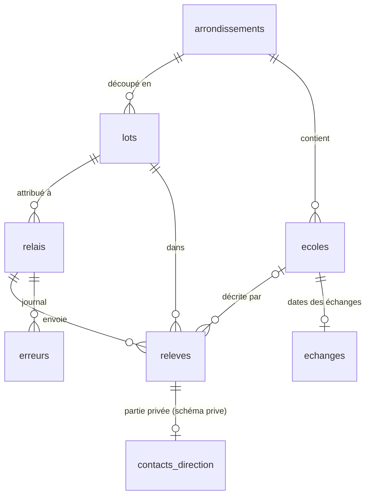

# Le schéma de la base

> **Validé le 31/10/2026** (trois choix tranchés par le fondateur, voir « Choix »). Les migrations (`supabase/migrations/`) font foi ; ce document en garde la carte et les raisons.
>
> Tiré de la proposition technique du 30/10 (modèle de données, droits) et des écrans du canevas « Site NTanova » : Ajouter 1/3 à 3/3, Mes fiches, À valider, Écoles, Compléter une fiche, Relais et paiements.

## Deux principes

1. **Un relevé n'est pas l'école.** Ce qu'un relais envoie est un relevé : une observation datée, signée, avec une position et une photo. L'école, c'est ce que l'administrateur a accepté. Plusieurs relevés peuvent décrire la même école : une correction, une contre-visite. On garde tous les relevés et on publie l'école.
2. **Le privé vit à part.** Les règles d'accès de Postgres filtrent des lignes, pas des colonnes : une colonne privée dans une table lisible finit par fuiter. Le contact de la direction vit donc dans le schéma `prive`, que l'API de Supabase n'expose pas du tout.

## La carte



La photo de l'enseigne va dans le stockage de Supabase (seau privé `releves`), sous `<id du relevé>/enseigne.jpg` : un chemin neutre, qui se copie tel quel ailleurs.

## Les tables (pour lundi 2/11)

| Table | Contenu | Qui lit | Qui écrit |
| --- | --- | --- | --- |
| `arrondissements` | Tié-Tié et Ngoyo : nom, slug, ville, contour OpenStreetMap, relation OSM | Tout le monde | Migration |
| `lots` | Nom, arrondissement, contour (vide : tout l'arrondissement), à rendre le, rendu le, **essai** | Le relais actif (le sien), l'admin | L'admin |
| `relais` | Compte, identifiant Google (`sub`), prénom, statut (en attente, actif, suspendu), lot | Le relais (sa ligne), l'admin | Créé à la première connexion ; l'admin l'active |
| `ecoles` | Ce qui peut être publié : nom, slug, arrondissement, quartier (tel qu'on le dit sur place), type, niveaux, repère, numéro de l'enseigne, position, état, publication, dates | Tout le monde : les fiches publiées | L'admin |
| `releves` | Voir ci-dessous | Le relais (les siens), l'admin | Le relais crée ; l'admin décide |
| `echanges` | Par école, des dates : premier message, réponse (et fonction de l'auteur), échange avec le décideur (appel ou rendez-vous), relances. Jamais le contenu | L'admin | L'admin |
| `erreurs` | Le journal de l'application relais, sans donnée personnelle | L'admin | Tout relais connecté (ajout seul) |
| `prive.admins` | Les comptes administrateurs | Personne par l'API | À la main (voir « Le premier jour ») |
| `prive.contacts_direction` | Fonction, nom, WhatsApp, accord pour être contacté (et sa date), ce qui a été dit | **L'admin seul**, par `contact_du_releve()` | Le relais, par `envoyer_contact()`, sans jamais pouvoir relire |

### `releves`, champ par champ

| Champ | Écran | Note |
| --- | --- | --- |
| `id` | — | **Créé sur le téléphone.** Un second envoi du même identifiant est refusé (code `23505`) : c'est « déjà reçu » |
| `relais_id`, `recu_le`, `statut` | — | Imposés par la base, jamais par le téléphone |
| `lot_id`, `type`, `corrige_releve_id` | — | Type : relevé, correction (liée au relevé corrigé), contre-visite |
| `position`, `precision_m`, `pris_le` | 1/3 | Point PostGIS ; précision en mètres ; l'heure du téléphone |
| `reponse_doublon`, `doublon_de` | 1/3 | Ce que le relais a répondu à « une école est déjà relevée à 40 m » |
| `nom_enseigne`, `niveaux`, `type_ecole`, `repere`, `numero_enseigne` | 2/3 | Public : ce qui se voit de la rue |
| `direction`, `fiche_liaison_remise`, `code_liaison`, `repasser` | 3/3 | Ce que « Mes fiches » montre au relais. Le contact lui-même part à part |
| `hors_lot`, `doublon_possible` | — | **Calculés par la base** : hors du contour du lot ; une école ou un autre relevé à moins de 40 m |
| `motif`, `message_au_relais`, `decide_le`, `ecole_id` | Admin | La décision |
| `contact_confirme_le`, `contact_fonction` | Admin | « Confirmé · promoteur » dans « Mes fiches », sans rien du contact |

### L'ordre d'envoi d'une fiche

**Le relevé, puis la photo, puis le contact** : la photo et le contact ne sont acceptés que pour un relevé déjà reçu et envoyé par le même relais. Chaque envoi peut être rejoué : le second répond « déjà reçu ».

## Les écoles à situer (31/10, après-midi)

Des écoles connues autrement que par un relevé (les entretiens) entrent **en brouillon, sans position**, parfois sans arrondissement. Jamais de position inventée : une fausse position tromperait une famille et fausserait le contrôle des doublons à 40 m.

1. **Import** : `node outils/importer-ecoles.ts <export.csv> > import.sql`, puis le SQL dans l'éditeur SQL de Supabase. Seulement ce qui se voit de la rue ; la référence (`ETB-…`) va dans `prive.ecoles_sources`, que l'API n'expose pas. Se relance sans doublon. Le CSV et le SQL restent hors du dépôt.
2. **Confier** : `confier_ecole(ecole, relais, note)` (administration, onglet « Écoles ») ; une école est confiée à un seul relais actif à la fois (`ecoles_confiees`). Le relais lit les écoles qu'on lui confie, même en brouillon ; personne d'autre.
3. **Contre-visite** : le relais envoie un relevé `contre_visite`, dont `doublon_de` est l'école visitée (contrainte `releves_contre_visite_liee`).
4. **Accepter** : `accepter_releve(releve, ecole)` met l'école à jour, lui donne l'arrondissement du relevé (sa position, sinon son lot), la publie si elle était en brouillon, et termine la mission (`ecoles_confiees`). Une école publiée a toujours un arrondissement (`ecoles_publiee_dans_un_arrondissement`).

## Les choix (31/10)

1. **Le contact dans un schéma privé**, écrit par une fonction (`envoyer_contact`) qui répond `recu` ou `deja_recu`. Même un droit donné par erreur ne le rendrait pas lisible par l'API. Demain, c'est `POST /contacts` chez Spring Boot.
2. **Pour lundi, un lot = un arrondissement entier** (contour vide). « Hors du lot » signale une école hors de Tié-Tié ou de Ngoyo. Les lots fins viendront quand leurs contours seront dessinés.
3. **Arrondissements, et un quartier libre** : Tié-Tié et Ngoyo sont des arrondissements ; l'école garde aussi le nom du quartier tel qu'on le dit sur place. Adresse d'une fiche : `ntanova.com/ecoles/tie-tie/<école>/`.

Fixé en écrivant les migrations :

- **Le lot est sur le relais** (`relais.lot_id`) et non l'inverse : plusieurs relais peuvent s'entraîner en même temps sur le lot « Essai ».
- **Une seule liste de niveaux** pour le relais et l'administration : maternelle, primaire, collège, lycée, technique, supérieur. L'« Institut » de l'écran Ajouter 2/3 devient « Technique » ou « Supérieur ».
- **Les listes fermées sont des domaines SQL**, copiés dans `src/modele/listes.ts` ; un test vérifie qu'ils restent identiques.

## Les droits

- **Visiteur** (`anon`) : lit les arrondissements et les écoles publiées (`ecoles_publiees`). Rien d'autre.
- **Relais en attente** : lit sa propre ligne (pour afficher « compte en attente »). Rien d'autre.
- **Relais actif** : envoie des relevés, des photos, des contacts et des erreurs ; lit ses relevés, son lot et les écoles publiées. **Ne lit jamais un contact, même le sien.** N'écrit que les colonnes du téléphone.
- **Admin** : tout, depuis son compte Google inscrit dans `prive.admins`, ou depuis l'éditeur SQL de Supabase Studio (rôle `postgres`).
- La migration des droits retire d'abord tout, puis donne table par table : en local, Supabase donne par défaut tous les droits à `anon` et `authenticated` ; en ligne, aucun. Les deux bases ont ainsi les mêmes droits.

## Les fonctions

| Fonction | Pour qui | Ce qu'elle fait |
| --- | --- | --- |
| `envoyer_contact(releve, fonction, nom, whatsapp, accord, accord_le, note)` | Relais actif | Range le contact ; répond `recu` ou `deja_recu`. Sans accord, aucun numéro |
| `activer_relais(relais, lot)` | Admin | Active un relais après sa formation et lui donne un lot |
| `accepter_releve(releve, ecole)` | Admin | Crée et publie la fiche relevée (ou met à jour l'école donnée, sauf si elle est vérifiée) ; jamais pour le lot d'essai. Une **correction** reprend l'école de la fiche corrigée et clôt celle-ci (« acceptée », même école) |
| `demander_correction(releve, motif, message)` | Admin | « La photo est floue, reprenez-la de face » |
| `refuser_releve(releve, motif, message)` | Admin | Refuse, avec un motif de la liste |
| `confirmer_contact(releve, fonction)` | Admin | La personne a confirmé sa fonction sur WhatsApp |
| `contact_du_releve(releve)` | Admin | Lit le contact d'un relevé |

Deux vues : `ecoles_publiees` (ce que lit le site public) et `releves_a_valider` (la file de l'administration, avec photo reçue et contact reçu).

## Les tests

`pnpm base:tests` (pgTAP, `supabase/tests/`) : 76 vérifications (39 pour les droits, 20 pour les décisions de l'administration, 17 pour les écoles à situer), dont celles du « fini quand » de la base : un relais ne lit aucun contact, même le sien ; un second envoi du même relevé répond « déjà reçu ». Ils tournent aussi dans la CI. Vérifié le 31/10 : en donnant à tort un droit aux relais, les tests échouent.

## Voir le schéma en local

1. `pnpm base:demarrer` (Docker), puis `pnpm base:reset` pour rejouer les migrations.
2. Supabase Studio : http://127.0.0.1:54323, menu **Database**, puis **Schema Visualizer** (schémas `public` et `prive`).

## Le premier jour en ligne

1. Relire les migrations, puis `pnpm exec supabase db push` (le mot de passe de la base est demandé).
2. Te connecter une première fois avec Google sur le site d'essai : la base crée ta ligne de relais, en attente.
3. Dans l'éditeur SQL de Supabase Studio, t'inscrire comme administrateur, avec ton adresse :

   ```sql
   insert into prive.admins (id) select id from auth.users where email = '<ton adresse>';
   ```

4. Pour chaque relais, après sa première connexion : dans l'administration (`/admin/`, onglet « Relais »), choisir son lot puis « Activer ». Sans l'administration : `select activer_relais('<son id>', (select id from lots where nom = 'Tié-Tié'));`

## Plus tard dans la semaine

| Quoi | Quand |
| --- | --- |
| `codes_liaison` : code, paquet, relais, imprimé le, relevé qui l'a utilisé. Le relais lit les codes de son paquet | Avant le premier paquet imprimé |
| Colonnes de la fiche vérifiée dans `ecoles` (frais datés, effectif, enseignants, séries, équipements, examens, mot de la direction, WhatsApp publié) et `ecoles_prive` (agrément, accord de publication, grille des frais, notes) | Avec « Compléter une fiche » |
| `photos` : façade, salle, cour, grille des frais ; publique ou non ; « sans enfant » vérifié le | Avec la fiche vérifiée |
| `evenements` : clic WhatsApp, scan d'autocollant ; école, canal, date | Avec le compteur `/go/` |
| Paiements des relais | Pas en novembre : le Sheet suffit |
